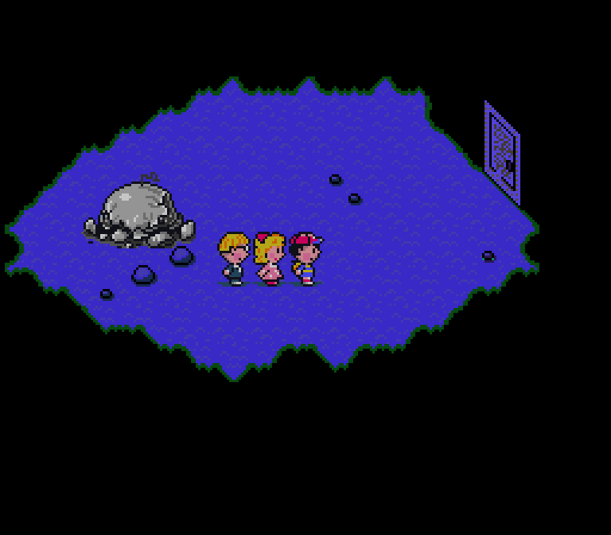
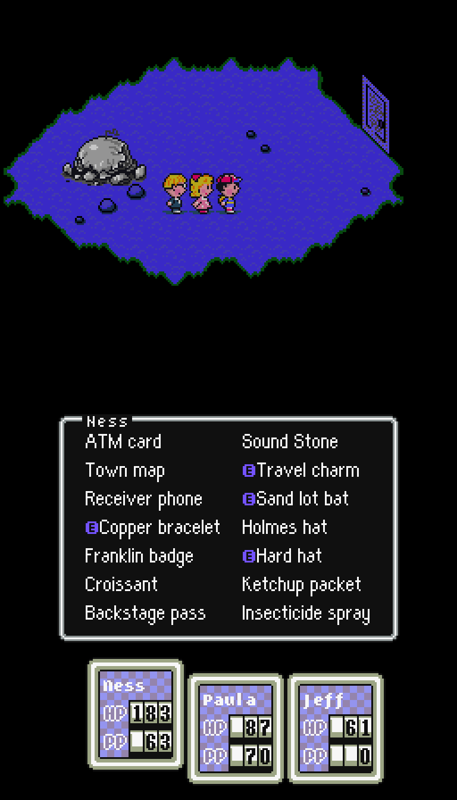
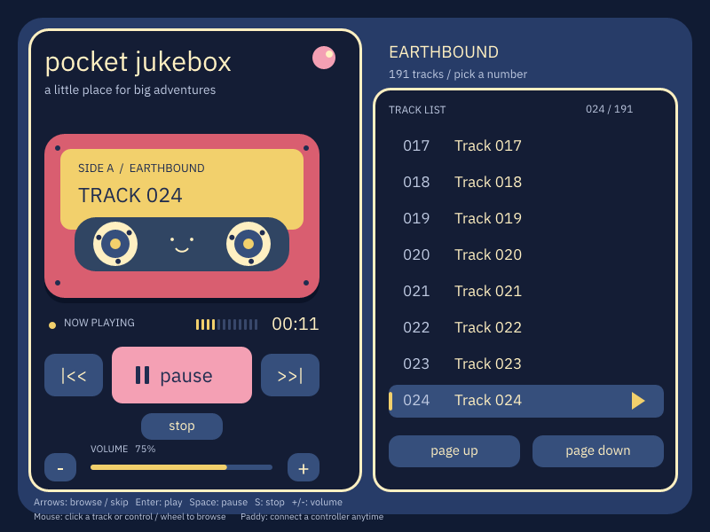
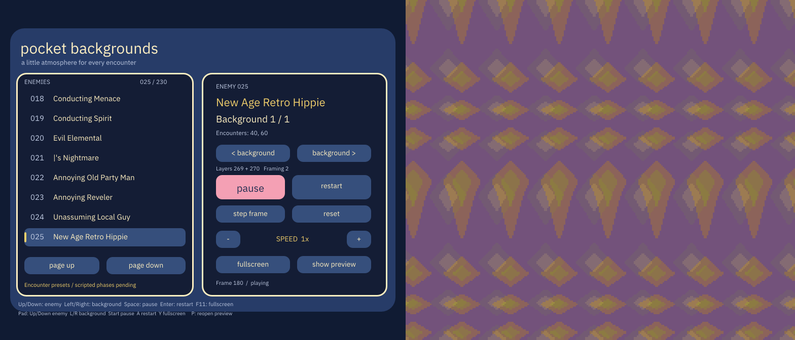
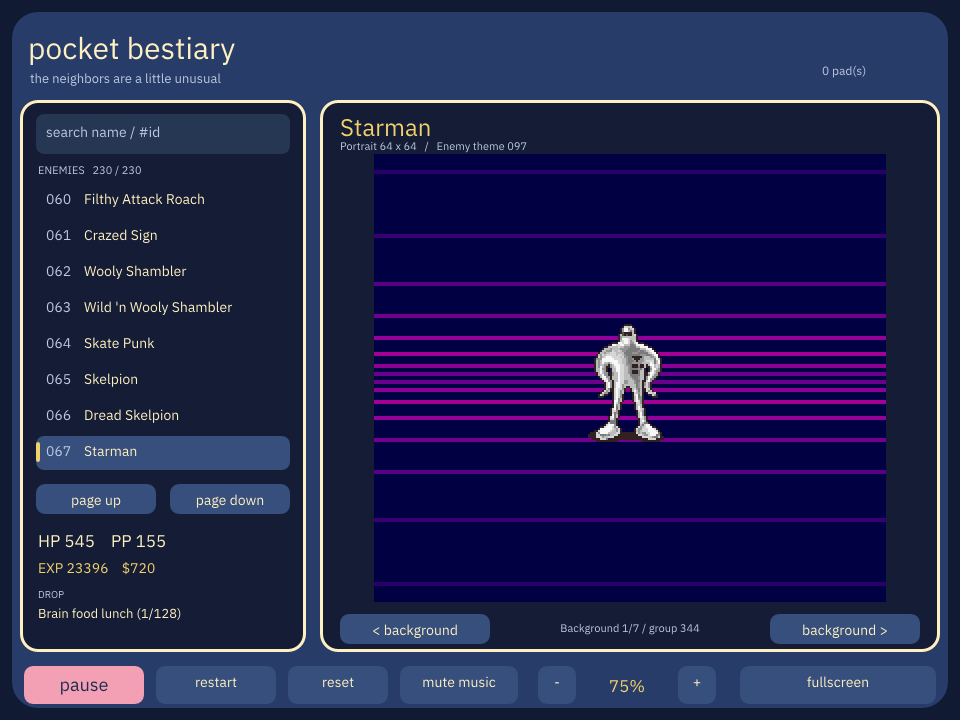
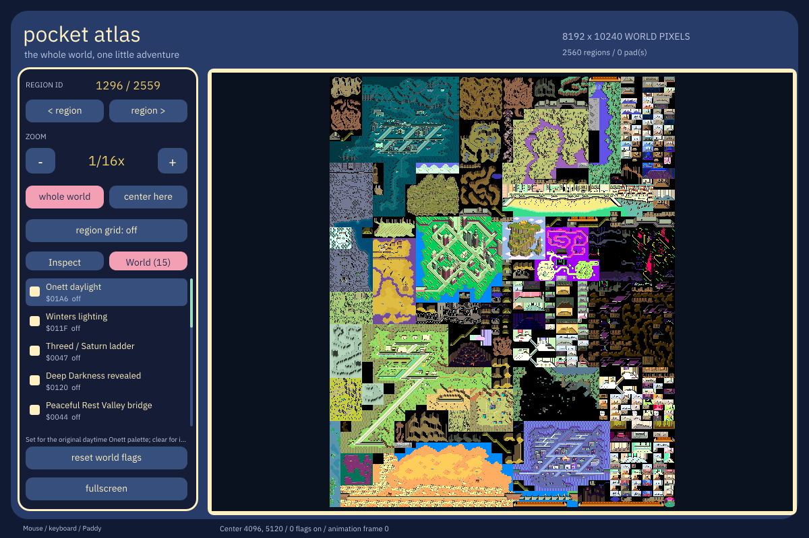

# decompbound

A **Nim SNES emulator focused on EarthBound**, with companion apps for exploring
its music, enemies, animated battle backgrounds, and world map, plus an ongoing
reverse-engineering and decompilation project for the US game.

Bring your own US ROM. The emulator and viewers load game data from it at
runtime; no ROM, extracted asset collection, or save-state is included.

## Play EarthBound



The emulator and companion apps showcase Nim's native library ecosystem:
[Windy](https://github.com/treeform/windy) for windows and keyboard input,
[Pixie](https://github.com/treeform/pixie) for image buffers and UI drawing,
[Paddy](https://github.com/treeform/paddy) for controller input, and
[Slappy](https://github.com/treeform/slappy) for stereo audio output.
The player also supports battery saves. The project records a complete human
playthrough through Giygas; remaining fidelity issues are tracked in
[the issue list](docs/issues.md).

```sh
make play
```

**Screenshots that remember where you were:** F12 saves a PNG with an embedded
save-state. Drop it onto the player to resume that moment. These screenstates
stay private; the illustrations in this README are image-only exports.
[How screenstates work →](docs/state-screenshots.md)

## EarthBound on two screens



The optional **EarthBound DS companion** leaves the complete game on one screen
and shows live inventory and party status on the other. The lower screen uses
the game's original fonts, window graphics, palettes, equipped symbols,
condition icons, and rolling HP/PP digits. Select a party member to browse their
items; the companion is read-only and item actions use the original game menus.

It runs through **mono-retro-player**, with two windows on desktop or separate
displays on supported dual-screen handhelds, including the Anbernic RG DS Plus.

```sh
make libretro-ds-play
```

Requires a separately built mono-retro-player with EarthBound DS support.
[Setup, handheld display mapping, and state loading →](docs/earthbound-ds.md)

## Pocket Jukebox



A little music player with an EarthBound-inspired cassette UI. Browse numeric
tracks and play the original music through our emulated SPC700/DSP, without
running the rest of the game. Mouse, keyboard, and Paddy controls share the
same playback actions. On supported Linux audio backends, the volume display
follows the app's actual mixer stream, including external slider changes.

```sh
make jukebox-app
```

[Controls, playback details, and audio limits →](docs/jukebox.md)

## Pocket Backgrounds



Browse battle backgrounds by enemy, in ROM record order, and explore the
encounter variants associated with each one. One window holds the controls;
the other shows just the animated background. Pause, step frames, change speed,
or put the artwork fullscreen. It supports mouse, keyboard, and Paddy input.

```sh
make battle-bg-app
```

The screenshot places the two window canvases side by side. The browser
reproduces encounter presets; special scripted boss phases remain research work.
[Controls and the enemy-to-background mapping →](docs/battle-backgrounds.md)

## Pocket Bestiary



Meet the neighbors: search enemy names or IDs, inspect battle portraits,
HP/PP, rewards, and item drops, and browse their encounter backgrounds.
The selected enemy's assigned battle music plays automatically. Mouse,
keyboard, and Paddy controls work here too. The supported catalog covers
230 enemy records; entries without standard portraits remain browsable.

```sh
make bestiary-app
```

[Catalog coverage, controls, and remaining research →](docs/bestiary.md)

## Pocket Atlas



Explore the whole 8192×10240-pixel world, with towns, caves and stored interiors
in their original atlas positions. Pan and zoom with mouse, keyboard, or Paddy;
click to inspect the region, arrangement, tileset, palette and tile flags.
The app composes scenery directly from your ROM using the original graphics
and palettes. The World tab toggles story-dependent lighting, bridges, ladders,
and other verified map changes, with named controls and flag IDs. It starts
with all flags clear and keeps the scenery static, without NPCs or gameplay
simulation.

```sh
make map-app
```

[Controls, original map formats, and decompilation evidence →](docs/world-map.md)

## Libretro integration

The same emulator builds as a Linux desktop or AArch64 **libretro `.so` core**,
providing video, audio, RetroPad input, and battery SRAM to the frontend.
It is exercised with mono-retro-player; the frontend handles windows, devices,
audio output, and scaling. Ordinary single-screen mode is the default.

```sh
make libretro
make libretro-play
```

The player can also import local decompbound screenstates at startup or when
dropped onto a desktop window. [Core setup and frontend contract →](docs/libretro.md)

## Decompilation and research

The project already rebuilds the English US ROM byte-for-byte using local
extraction, annotated assembly, and copied residual regions. Understanding the
whole game remains the long-term goal. Progress is one verified region at a
time; the gold ROM is always the referee.

See **[GOAL.md](GOAL.md)** for the canonical goals, completion criteria, and
investigation loop. The current game-source target is annotated 65816 assembly;
Nim implements the tools and emulator.

## Goals

| | Goal | Status |
|---|------|--------|
| **1** | Rebuild the original ROM byte-identically | **Met; maintain** — extraction + assembly + copied residual regions |
| **2** | Understand all game code | **Early** — 55 explained assembly regions, plus further research in tools/docs |
| **3** | Understand scripting | **Partial** — text decoding and action-script machinery; complete semantics remain open |
| **4** | Understand graphics, including the game map | **Partial** — complete base world atlas, enemy portraits, battle backgrounds, and original UI; animation/story variants and the full asset catalog remain open |
| **5** | Understand audio | **Partial** — standalone music playback and upload/song-loader knowledge; complete driver/sequence understanding remains open |

## Current state

- **Vanilla rebuild:** `make compare` extracts the user's ROM into ignored
  `extracted/` files and rebuilds it using `manifest.json` and `asm/`. The output
  must be byte-identical. Copied bytes do not count as understood code or assets.
- **Explained regions:** the current manifest contains 4,145 explained and
  reproduced bytes (0.1318% of the whole 3 MiB ROM). Other knowledge lives in
  subsystem docs and tools; there is no complete code-only denominator yet.
- **Emulator:** the repo records a complete human EarthBound playthrough through
  Giygas on the Nim SNES core. Remaining fidelity issues are tracked in
  [docs/issues.md](docs/issues.md). Playability supports the research goals.
- **Supporting tools:** F12 state-screenshots, TAS replay, Lua/LLM play experiments,
  Pocket Jukebox, Pocket Backgrounds, Pocket Bestiary, Pocket Atlas, the DS companion,
  asset exporters, and an MCP co-pilot. These support investigation and provide
  useful ways to play and explore; they are not separate decompilation goals.
- **Asset policy:** supply your own US ROM at `bin/Earthbound (U) [!].smc`.
  Extracted assets, scripts, saves, and screenstates stay local and uncommitted.
  A few curated, image-only README screenshots are the documentation exception.

Older documents may use the retired goal numbering and generated Nim bank paths.
[GOAL.md](GOAL.md) and the [phase-2 plan](docs/decompilation-phase2.md) define the
current direction. `generated/` and `snes_src/` have been replaced by the manifest
and annotated assembly; native Nim reimplementation is outside the current goals.

## Quick start

Use Nim 2 or newer and the repository's dependencies. On Nix, enter
`nix develop` first to provide the native window, gamepad, and audio libraries
declared in `flake.nix`. All feature commands above run from the repository root
in that environment with your ROM available.

Applications and libretro cores default to shipping builds with compiler runtime
checks disabled (`danger`). Use `-d:debug` for checked developer builds with
stack traces, for example `nim c -d:debug src/libretro/core.nim`. Tests default
to checked builds; explicit input validation remains active in both profiles.

```bash
# Put your legally obtained US ROM at:
#   bin/Earthbound (U) [!].smc

make compare          # build decomp ROM + compare vs gold
make check            # nim check entrypoints + tests (compile only)
make test             # unit suite (builds vendor/lua when needed)
make libretro         # headless Linux desktop core: bin/libretro/decompbound_libretro.so
make libretro-play    # test it in the separately built mono-retro-player
make libretro-ds-play # dual-screen game + party companion in mono-retro-player
make play             # windowed emulator
make jukebox-app      # music player
make battle-bg-app    # background browser: controls + artwork windows
make bestiary-app     # enemy portraits, stats, backgrounds, and battle music
make map-app          # complete base world atlas, including interiors
make llm-ai           # live qwen Agent (needs local model)
make llm-ai-scripted  # deterministic seed Lua, no qwen (watch product seeds)
make llm-ai-scripted-campaign  # same + campaign seats past sleep/walls
make mcp              # playthrough co-pilot MCP (http://localhost:4343/mcp)
```

Other useful targets: `make help`, `make intro`, `make jukebox`, `make audio-check`.
`make jukebox` is the headless WAV renderer; `make jukebox-app` opens the player.
Use `ROM="/path/to/your.sfc"` to select another local ROM path.

`make bestiary-app` opens [Pocket Bestiary](docs/bestiary.md): enemy portraits,
core stats, animated encounter backgrounds and automatic battle music.
`make bestiary-build` builds it without opening a window.

`make battle-bg-app` opens [Pocket Backgrounds](docs/battle-backgrounds.md), a
two-window enemy background browser with mouse, keyboard and Paddy controls.
`make battle-bg-build` builds it without opening windows.

`make jukebox-app` opens [Pocket Jukebox](docs/jukebox.md), the music-only Nim
player with mouse, keyboard and Paddy controls. `make jukebox-build` builds it
without launching a window.

The [libretro core](docs/libretro.md) provides video, audio callbacks, controller
input, and battery SRAM for mono-retro and other libretro frontends.

## Rules (short)

- **No raw byte literals in code regions.** Express code as mnemonics through
  the assembler. Unknowns are declared **data** with TODOs — never fake progress
  with copied hex.
- Prefer real meaning over magic constants; magic that must land temporarily
  needs a TODO + comment.
- **Copyright hygiene:** no ROM, extracted assets, save-states, SRAM, or dialogue
  dumps. A few curated, image-only screenshots under `docs/images/` illustrate
  README features; original F12 screenstates are never included. Game artwork
  remains the property of its rightsholders and is not licensed as project code.
  The user supplies the ROM; game data is extracted at run time. See `AGENTS.md`.

## Docs

| Doc | What |
|-----|------|
| [GOAL.md](GOAL.md) | Goals, completion criteria, investigation loop |
| [docs/libretro.md](docs/libretro.md) | Shared core and mono-retro-player integration |
| [docs/earthbound-ds.md](docs/earthbound-ds.md) | Dual-screen party and inventory companion |
| [docs/jukebox.md](docs/jukebox.md) | Pocket Jukebox |
| [docs/battle-backgrounds.md](docs/battle-backgrounds.md) | Pocket Backgrounds and encounter presets |
| [docs/bestiary.md](docs/bestiary.md) | Pocket Bestiary and portrait formats |
| [docs/world-map.md](docs/world-map.md) | Pocket Atlas, map formats and original-code evidence |
| [docs/decompilation-phase2.md](docs/decompilation-phase2.md) | Current extract/rebuild pipeline |
| [docs/goal-1.md](docs/goal-1.md) | Historical boot-path assembly milestone |
| [docs/goal-1.5.md](docs/goal-1.5.md) | Historical adoption campaign |
| [docs/decompilation.md](docs/decompilation.md) | How tracing / coverage works |
| [docs/human-verify.md](docs/human-verify.md) | Playtest checklist for humans |
| [docs/issues.md](docs/issues.md) | Known emulator / fidelity issues |
| [docs/llm-plays.md](docs/llm-plays.md) | LLM-play harness |
| [docs/llm-sequence.md](docs/llm-sequence.md) | Story percent ladder |
| [docs/mcp-server.md](docs/mcp-server.md) | MCP playthrough co-pilot |
| [docs/audio.md](docs/audio.md) | Audio / SPC track |
| [docs/delegation.md](docs/delegation.md) | Multi-agent work style |
| [docs/state-screenshots.md](docs/state-screenshots.md) | F12 screenshots that embed save-state |
| [docs/images/README.md](docs/images/README.md) | Curated README image inventory and export rules |

External SNES references: [SNES memory map](https://en.wikibooks.org/wiki/Super_NES_Programming/SNES_memory_map),
[superfamicom.org wiki](https://wiki.superfamicom.org/),
[SnesLab quick links](https://www.sneslab.net/wiki/Official_Documentation_Quick_Links).

## Acknowledgement

EarthBound and its game artwork belong to their respective rightsholders.
decompbound is an independent project, unaffiliated with and not endorsed by
Nintendo. Screenshots illustrate project features; game artwork is not covered
by this repository's source-code license. No ROMs or game assets for running
the software are provided.
