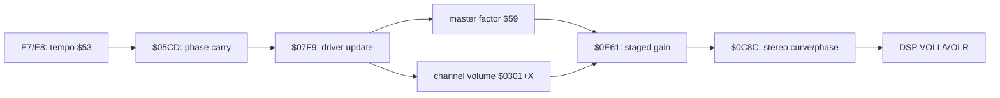

# Audio

Goal 5 in [GOAL.md](../GOAL.md) is to explain the path from game commands to
SPC700 driver execution, sequences, instruments, samples, and DSP output.
The emulator already has SPC700/APU/DSP playback. Working audio is evidence
about playback, not proof that the uploaded driver or sequence language is
understood.

For the driver reference, start with the [command entrypoint inventory](#command-entrypoint-inventory),
[tempo/volume state](#tempo-and-master-volume-transitions),
[modulation setters and resets](#modulation-commands-and-accepted-event-resets),
or [sequence calls and word controls](#sequence-calls-and-global-control-words).

## Existing tools and evidence

- `src/decompbound/spc700.nim`, `apu.nim`, and `dsp.nim` implement the audio
  machine. `tests/integration_spc700.nim` exercises CPU vectors;
  `tests/integration_apu_upload_starvation.nim` exercises full-game boot/upload.
- `src/decompbound/music_player.nim` validates the song/package tables and loads
  packages into a fresh APU. It is shared by both standalone music tools.
- `src/tools/sound_explore.nim` uses that engine and
  renders a WAV under ignored `bin/` or another explicitly selected local path.
- `src/tools/jukebox_app.nim` provides [Pocket Jukebox](jukebox.md), a mouse,
  keyboard and Paddy GUI for that standalone loading path.
  Its numeric song list is not a verified soundtrack identity catalog.
- `src/probes/songstart_dig.nim` compares package targets and driver state for
  two songs, including the deliberately incomplete case without package 1.
  Run `nim r src/probes/songstart_dig.nim --a:1 --b:3`.
- [Music](music.md) tracks standalone playback gaps; [DSP research](sfx.md)
  covers synthesis behavior. Human listening checks belong in
  [human-verify.md](human-verify.md).

Direct package loading does not execute the S-CPU/IPL handshake or reproduce
all resident-state/cache behavior of a song change during play. The standalone
tools share a parser that rejects truncated packages and out-of-range references
and APU destinations. Direct loading still does not establish every runtime
upload boundary or resident-state contract.

## Song selection and resident packages

The song table at file `$04F70A..04F946` has 191 three-byte rows, indexed
`(songId - 1) * 3`. Each byte is a package index or `$FF` for an unused slot.
The adjacent pointer table `$04F947..04FB41` has 169 entries, each three bytes
in **bank, address-low, address-high** order. Local inspection finds all 169
indices referenced by the song table, with maximum index 168. These are table
extents, not runtime bounds checks: the loader does not validate IDs this way.

`$C4FB58` initializes resident audio data using the first song's third package
index, seeds caches `$B543/$B53F`, and uploads it at `$C4FBB1`. The checked ROM
selects package 1 here.

`$C4FBBD` handles later song selection:

- Matching current song `$B53B` returns without reloading.
- The three package slots compare against caches `$B53D/$B53F/$B541`.
- `$FF` entries and matching cached indices skip uploading. Slot 1 also skips
  when its index matches alternate cache `$B543`.
- Changed packages go through `$C0AB06`; the tail sends the song command to
  APU port 0 through `$C0ABBD`.

Thus a song change does **not** imply reuploading the driver or all three
packages. Shared resident data is part of the playback contract. The exact
roles of `$B4B6` and special song IDs `$A0..A7` remain open; the latter skip
the ordinary stop handshake. See `asm/loadSong.asm` and the port helpers.

## Package format and upload protocol

At `$C0AB06`, A supplies the package address and X its bank. The streamer uses
the four S-CPU APU ports `$2140..2143`, disables NMI during transfer, and walks:

```
u16 length
if length != 0:
    u16 destination
    length payload bytes
    repeat
else:
    finish; execute at APU $0500
```

The terminator is **two bytes**, the zero length alone. At `$C0AB62..AB73`,
the zero branch substitutes `$0500` without consuming a destination word.
Bytes following that terminator must not be interpreted as an entrypoint.
For nonempty blocks, destination and payload follow the length. `$C0AB78`
tests `length >= 1` to form the transfer flag, not `length == 1`.
The final path forces NMI enabled; it does not restore a saved enable bit.
These are S-CPU disassembly findings, independently checked against the local
ROM. They do not yet establish all package boundary/cross-bank corner cases.

## Bootstrap provenance

Package 1 starts at file `$260000`. Its block header at `$26003E` describes
16,779 bytes destined for APU `$0500`; payload begins at `$260042`. The bootstrap
is part of this ROM package, not something deposited by the IPL protocol.

Standalone players prepend package 1 when a song omits it, because a fresh APU
has no resident driver. Inspection of all 191 song-table rows with that loading
policy confirms that the first 32 entry bytes remain those from `$260042`.
The tools therefore use the user's ROM directly; no captured bootstrap byte
array is needed or retained in source.

Verification of that cleanup included a one-second song-1 render whose WAV
was byte-identical before and after removal, and the song-start probe for songs
1 and 3. Both complete loading paths produced nonzero audio and a running SPC;
the intentional song-3 case without package 1 still halted. This does not prove
all 191 songs sound correct or that their sequences are fully decoded.

## Reproduced SPC700 source

The fixed-layout build now assembles eighty-four annotated `.spc.asm` files with
our Nim SPC700 assembler. They reproduce **2,169 executable bytes** in package 1.
The upload block header at file `$26003E` declares 16,779 bytes from file
`$260042` to APU `$0500`; therefore `file = apuAddress + $25FB42` within it.
Each source's `.org` is its APU execution address, not a ROM padding request.

| Source | APU range | File range | Bytes |
|---|---|---|---:|
| `spcInitializeDriverRam.spc.asm` | `$0500..050B` | `$260042..26004D` | 12 |
| `spcInitializeDriverHardware.spc.asm` | `$050C..0542` | `$26004E..260084` | 55 |
| `spcFlushDsp.spc.asm` | `$0543..0578` | `$260085..2600BA` | 54 |
| `spcPollTimer.spc.asm` | `$0579..058B` | `$2600BB..2600CD` | 19 |
| `spcCheckServiceReset.spc.asm` | `$058C..0595` | `$2600CE..2600D7` | 10 |
| `spcRunServicePass.spc.asm` | `$0596..05C5` | `$2600D8..260107` | 48† |
| `spcAdvanceEchoSettle.spc.asm` | `$05C6..05CC` | `$260108..26010E` | 7 |
| `spcAdvancePhase.spc.asm` | `$05CD..05D7` | `$26010F..260119` | 11 |
| `spcRouteSequenceUpdate.spc.asm` | `$05D8..05FB` | `$26011A..26013D` | 36 |
| `spcReturnToIpl.spc.asm` | `$05FC..0624` | `$26013E..260166` | 41 |
| `spcExchangeHostPortZero.spc.asm` | `$0625..0634` | `$260167..260176` | 16 |
| `spcSampleHostPort.spc.asm` | `$0635..0653` | `$260177..260195` | 31 |
| `spcPrepareChannelEvent.spc.asm` | `$0654..0683` | `$260196..2601C5` | 48 |
| `spcResetEventState.spc.asm` | `$0684..0695` | `$2601C6..2601D7` | 18 |
| `spcInitializeEventPitchTransition.spc.asm` | `$0696..06BD` | `$2601D8..2601FF` | 40 |
| `spcConvertEventPitch.spc.asm` | `$06BE..070D` | `$260200..26024F` | 80 |
| `spcPitchScale.spc.asm` | `$070E..0732` | `$260250..260274` | 37 |
| `spcWritePitch.spc.asm` | `$0733..0740` | `$260275..260282` | 14 |
| `spcWriteDsp.spc.asm` | `$0741..074F` | `$260283..260291` | 15 |
| `spcFetchSequenceWord.spc.asm` | `$0750..075D` | `$260292..26029F` | 14 |
| `spcSelectSequence.spc.asm` | `$0772..0799` | `$2602B4..2602DB` | 40 |
| `spcStopSequence.spc.asm` | `$07EA..07F3` | `$26032C..260335` | 10 |
| `spcReadSequenceControl.spc.asm` | `$081A..0840` | `$26035C..260382` | 39 |
| `spcLoadSequenceBlock.spc.asm` | `$0841..0870` | `$260383..2603B2` | 48 |
| `spcBeginChannelPass.spc.asm` | `$0871..0881` | `$2603B3..2603C3` | 17 |
| `spcFetchSequenceEvent.spc.asm` | `$0882..089D` | `$2603C4..2603DF` | 28 |
| `spcParseSequencePrefix.spc.asm` | `$089E..08E5` | `$2603E0..260427` | 72 |
| `spcServiceSequenceEvent.spc.asm` | `$08E6..08EF` | `$260428..260431` | 10 |
| `spcNextSequenceChannel.spc.asm` | `$08F0..08F5` | `$260432..260437` | 6 |
| `spcTickTempoTransition.spc.asm` | `$08F6..0904` | `$260438..260446` | 15 |
| `spcTickEchoVolumeTransition.spc.asm` | `$0905..091D` | `$260447..26045F` | 25 |
| `spcTickMasterVolumeTransition.spc.asm` | `$091E..092F` | `$260460..260471` | 18 |
| `spcDispatchCommand.spc.asm` | `$0943..0954` | `$260485..260496` | 18 |
| `spcSequenceFetch.spc.asm` | `$0955..095E` | `$260497..2604A0` | 10 |
| `spcSelectInstrument.spc.asm` | `$095F..09B7` | `$2604A1..2604F9` | 89 |
| `spcSetPan.spc.asm` | `$09B8..09D5` | `$2604FA..260517` | 30 |
| `spcSetPanTransition.spc.asm` | `$09D6..09FC` | `$260518..26053E` | 39 |
| `spcConfigurePitchModulation.spc.asm` | `$09FD..0A08` | `$26053F..26054A` | 12 |
| `spcSetPitchModulationDepth.spc.asm` | `$0A09..0A13` | `$26054B..260555` | 11 |
| `spcSetPitchModulationRamp.spc.asm` | `$0A14..0A23` | `$260556..260565` | 16 |
| `spcSetMasterVolume.spc.asm` | `$0A24..0A28` | `$260566..26056A` | 5 |
| `spcSetMasterVolumeTransition.spc.asm` | `$0A29..0A3A` | `$26056B..26057C` | 18 |
| `spcSetTempo.spc.asm` | `$0A3B..0A3F` | `$26057D..260581` | 5 |
| `spcSetTempoTransition.spc.asm` | `$0A40..0A51` | `$260582..260593` | 18 |
| `spcSetGlobalPitchOffset.spc.asm` | `$0A52..0A54` | `$260594..260596` | 3 |
| `spcSetChannelPitchOffset.spc.asm` | `$0A55..0A58` | `$260597..26059A` | 4 |
| `spcConfigureVolumeModulation.spc.asm` | `$0A59..0A64` | `$26059B..2605A6` | 12 |
| `spcSetVolumeModulationDepth.spc.asm` | `$0A65..0A67` | `$2605A7..2605A9` | 3 |
| `spcConfigurePitchTransition.spc.asm` | `$0A68..0A81` | `$2605AA..2605C3` | 26 |
| `spcSetPendingPitchTransitionDuration.spc.asm` | `$0A82..0A85` | `$2605C4..2605C7` | 4 |
| `spcSetChannelVolume.spc.asm` | `$0A86..0A8E` | `$2605C8..2605D0` | 9 |
| `spcSetVolumeTransition.spc.asm` | `$0A8F..0AA7` | `$2605D1..2605E9` | 25 |
| `spcSetEventPitchFraction.spc.asm` | `$0AA8..0AAB` | `$2605EA..2605ED` | 4 |
| `spcCallSequence.spc.asm` | `$0AAC..0ACE` | `$2605EE..260610` | 35 |
| `spcSetEchoChannelsAndVolume.spc.asm` | `$0ACF..0AE1` | `$260611..260623` | 19 |
| `spcSetEchoVolumeTransition.spc.asm` | `$0AE2..0B02` | `$260624..260644` | 33 |
| `spcDisableEchoWrites.spc.asm` | `$0B03..0B09` | `$260645..26064B` | 7 |
| `spcConfigureEcho.spc.asm` | `$0B0A..0B2B` | `$26064C..26066D` | 34 |
| `spcConfigureEchoDelay.spc.asm` | `$0B2C..0B71` | `$26066E..2606B3` | 70 |
| `spcSetInstrumentRemapBase.spc.asm` | `$0B72..0B74` | `$2606B4..2606B6` | 3 |
| `spcSkipSequenceOperand.spc.asm` | `$0B75..0B78` | `$2606B7..2606BA` | 4 |
| `spcSetChannelEventGuard.spc.asm` | `$0B79..0B7D` | `$2606BB..2606BF` | 5 |
| `spcIncrementSequenceMode.spc.asm` | `$0B7E` | `$2606C0` | 1 |
| `spcSetSequenceProcessingMode.spc.asm` | `$0B7F..0B83` | `$2606C1..2606C5` | 5 |
| `spcServiceHeldPitchTransition.spc.asm` | `$0B84..0B93` | `$2606C6..2606D5` | 16 |
| `spcStartActivePitchTransition.spc.asm` | `$0B94..0BA3` | `$2606D6..2606E5` | 16 |
| `spcSetPitchTransitionTarget.spc.asm` | `$0BA4..0BBB` | `$2606E6..2606FD` | 24 |
| `spcReadChannelPitch.spc.asm` | `$0BBC..0BC6` | `$2606FE..260708` | 11 |
| `spcDivideStep.spc.asm` | `$0BC7..0BE2` | `$260709..260724` | 28 |
| `spcTickChannelVolume.spc.asm` | `$0C40..0C78` | `$260782..2607BA` | 57 |
| `spcTickPanTransition.spc.asm` | `$0C79..0C8B` | `$2607BB..2607CD` | 19 |
| `spcWriteStereo.spc.asm` | `$0C8C..0CD2` | `$2607CE..260814` | 71 |
| `spcApplyPanStep.spc.asm` | `$0CD3..0CF6` | `$260815..260838` | 36 |
| `spcLookAheadSequence.spc.asm` | `$0CF7..0D5F` | `$260839..2608A1` | 105 |
| `spcTickPitchTransition.spc.asm` | `$0D60..0D7B` | `$2608A2..2608BD` | 28 |
| `spcTickPitchModulation.spc.asm` | `$0D7C..0DCF` | `$2608BE..260911` | 84 |
| `spcPreviewVolumeModulation.spc.asm` | `$0DD0..0DDE` | `$260912..260920` | 15 |
| `spcPreviewPan.spc.asm` | `$0DDF..0DFB` | `$260921..26093D` | 29 |
| `spcPreviewPitchTransition.spc.asm` | `$0DFC..0E12` | `$26093E..260954` | 23 |
| `spcPreviewPitchModulation.spc.asm` | `$0E13..0E2A` | `$260955..26096C` | 24 |
| `spcScaleSignedStep.spc.asm` | `$0E2B..0E48` | `$26096D..26098A` | 30 |
| `spcPreviewVolumePhase.spc.asm` | `$0E49..0E55` | `$26098B..260997` | 13 |
| `spcModulateChannelGain.spc.asm` | `$0E56..0E60` | `$260998..2609A2` | 11 |
| `spcComputeChannelGain.spc.asm` | `$0E61..0E72` | `$2609A3..2609B4` | 18 |

† The 48-byte service pass is reproduced/identified, not explained: its call
order and bounded idle-state behavior are established, but broader callee roles
remain open. The other seven new regions add 208 explained bytes, for 83
explained SPC regions totaling 2,121 bytes. Byte reproduction and comprehension
are separate.

The pitch scale and pitch writer share fall-through tails; the stereo writer
also exposes scratch-coordinate entry `$0C95`. Their contracts are kept next
to those entries. The E2 tick prelude ends at `$0C8B`: `$0C8A` is the opcode
of a two-byte branch, so stopping there would split an instruction. The division
region also owns callable conditional-negation entry `$0BD9`; its contract is
documented beside that entry.

`nim r tests/test_spc_asm.nim` checks all 256 opcode encodings against independent
literal synthetic fixtures, plus operand order, origins, labels, signed branch
limits/wrap, bit packing and rejection of invalid or oversized operands.
`nim r tests/integration_rom_pipeline.nim` independently checks SPC label origin
versus ROM placement in a mixed 65816/SPC build, exact-length rejection and the
whole-ROM gold rebuild. The source bytes at the file offsets above were individually
compared with the user's ROM, including all 256 bytes in the eight startup/service/
port regions. Fresh extraction/rebuild is byte-identical across all 3,145,728 bytes.
All 35 focused test programs passed after adoption, including the four startup,
timer-service, host-port and phase-routing suites on original and freshly rebuilt
images. These checks do not promote the identified service fragment to explained.

The sequence-fetch, pitch-scale, pan, pan-transition, arithmetic, phase, tempo,
volume, modulation-command, sequence-control, lifecycle, pitch-offset,
conversion, pitch-modulation, pitch-transition, active-F9, prefix and lookahead tests execute
both original and freshly rebuilt driver images, checking mathematical results,
state effects and ordered DSP-port writes. No audio output is needed for those
gates. Remaining code, curves, instruments, songs and effects still enter the
build through the user's local extraction; reproducing these routines does not
claim full driver understanding, musical correctness or complete audio timing.

## Driver initialization and phase generation

The bootstrap at APU `$0500..050B` selects direct page zero, resets hardware
SP to `$CF`, and clears exactly `$0000..00DF` using `(X)+` until X reaches `$E0`.
It establishes the zero word at `$0E/$0F` and phase byte `$51` even from dirty
RAM with PSW page one. `$00E0..00FF` and page one remain untouched by this block;
the next source continues initialization at `$050C..0542` (file
`$26004E..260084`). It calls `$16A5`, seeds feedback bytes `$18/$19=$55`,
requests echo delay 1 through `$0B2C`, and sets FLG shadow `$48.5`. The actual
clear-helper chain clears `$0420..04FF` and `$E800..FEFF`, then seeds
`$04D1..04D4` with `$1D,$09,$80,$C0`; these external helper instructions are
not included in the 55-byte startup source, and those fields' game-level roles
remain open. It writes DSP MVOLL/MVOLR=`$70`
and DIR=`$6C`, selects CONTROL=`$F0` (timers disabled, all input ports cleared,
IPL mapped), sets timer-zero target and tempo integer `$53` to `$10`, then
CONTROL=1 enables only timer zero and unmaps IPL. The nonzero A branches directly
to flush `$0546`, skipping the bypass jump at `$0543`.

Echo initialization reads old hardware EDL once. Request `$4D=1` leaves settle
`$4C=0` if readback is already 1, otherwise `$4C=255-(oldEDL&15)`;
ESA becomes `$F7`. The entry makes no host-output-port write or timer-counter
read. At `$0546`, A=1, X=0, Y=`$5D`, SP=`$CF`; C/H are set, V/N/Z/P clear,
and I/B preserved. Its real nested calls write native-stack slots down to
`$01CC`; page one is therefore preserved by the initial clear, not by the
complete startup chain.

At `$0579` (file `$2600BB`) the driver reads timer-0 counter `$00FD`. Zero
keeps it polling without pushing a count. A nonzero count is pushed at `$057E`.
The first accumulator is `$43 = (old43 + ((count*32)&255))&255`; only that
low-byte addition’s carry routes execution. No carry branches to `$05CD`;
carry jumps directly to service entry `$0596`, bypassing `$058C`. Actual
nonzero timer reads are 1..15; synthetic full-byte counts test the raw arithmetic
without claiming that hardware emits them. In particular, product high bits do
not force service (count 8 has low product zero).

The 48-byte service pass calls `$1609,$2DAB,$2DF3,$2DD5,$11DC`, samples host
port 3 through `$0635` and stores its result at `$04B3`, calls `$2E1D,$11BA`,
samples port 2 into `$04B2`, calls `$1198`, then samples port 1 into `$04B1`.
It falls through settle updater `$05C6` before phase math. Original-callee
idle-state checks establish that order and preserve the pending timer frame;
they do not explain every callee’s broader RAM, port or command effects.

The separate `$058C..0595` entry compares `$04B1` with `$AA`. Ordinary values
fall into the same service pass; equality calls the nonreturning IPL transfer
at `$05FC`. No normal upstream reachability for this entry has been established.
Its own instructions do not push a timer byte; continuing through `$05CD`
still requires a valid pending frame. The phase fragment recovers that byte at
`$05CF` and starts at `$05CD`:

```
product = savedTimerCount * byte[$53]
sum = oldPhase + (product & 255)
phase[$51] = sum & 255
```

Only the low product participates in ADC and its carry. Y retains the product's
high byte, but it does not affect routing. Carry falls through at `$05D8` to
calls `$07F9` and `$0625`; no carry branches to `$05E0`, where active byte `$04`
permits channel preview through `$0DD0`. The timer target and `$53` are initially
set to `$10` at `$0535..053A`; `$07E0` also writes `$20` to `$53`. The E7/E8
tempo commands are explained below. Broader service-callee roles, upstream
reachability of the alternate reset entry and absolute scheduling rate remain
open. CPU cycle accounting is approximate; these routes establish no absolute
cadence. `$51` is a fractional accumulator, not a wall-clock sample counter.

`nim r tests/integration_spc_phase.nim` runs **2,102,264 cases** across original
and rebuilt images: all dirty RAM/status byte seeds,
every four-bit timer-count/tempo/phase combination, larger authored counts that
distinguish low-product carry, and every hardware stack pointer. It injects the
pending timer byte and stops at the branch exits; it does not claim coverage of
the polling loop, service calls or `$04` gate. The retained sequence trace below
also checks phase arithmetic and branch routing during actual silent song-3
driver execution using the shared product package loader.

### Host-port exchange, update routing and IPL handoff

`$0625..0634` publishes activity/selection byte `$04` to output port zero
`$F4`, then reads input port zero in pairs until a pair agrees. It stores the
stable byte in `$00`. The write precedes every input read; termination requires
a matching pair, not a fixed retry count. It preserves X/Y/H/V/P/I/B and returns
A=stable byte, C=1/N=0/Z=1. Input and output directions are distinct in our APU.

`$0635..0653` takes X as a port index (the service uses 3,2,1), saves old
`$04A4+X` in scratch `$20`, and similarly waits for two equal reads at
`$F4+X`. It stores the stable input at `$00+X`, echoes it to that port, and
updates `$04A4+X`. A and `$04A0+X` receive the byte when changed, otherwise
zero; a changed-to-zero input also returns zero. C/N/Z reflect stable-minus-old
CMP even when its following MOV selects zero. X/Y/H/V/P/I/B and the caller’s
native frame are preserved. These helpers establish transport and suppression,
not an identity for every command carried by those ports.

Phase carry entry `$05D8` calls normal sequence update `$07F9` and the
port-zero exchange, then returns to flush `$0546`. No-carry preview entry
`$05E0` skips directly to that flush when `$04=0`; otherwise it visits all
eight even channel offsets, with one-hot `$47`, calling `$0DD0` only when
cursor high byte `$31+X` is nonzero. A nonzero low cursor alone is inactive.
Preview callees preserve persistent phase/counters while updating derived
scratch/gain and possibly DSP ports. Active traversal ends X=16, `$47=0`,
C=1/N=0/Z=1; calls balance SP. Neither routing entry RETs or jumps to `$058C`.
This bounded traversal does not explain the full normal-update callee.

`$05FC..0624` unconditionally writes hardware EVOLL/R=0, KOFF=`$FF`, EON=0
and FLG=`$20`, using writer `$0749`; buffered shadows remain unchanged and
`$1A/$1B` do not inhibit it. CONTROL=`$80` disables all three timers and maps
IPL, then JMP `$FFC0` hands off without RET. Internal calls balance; an
external CALL frame remains live. A=`$80`, Y=`$6C`, X preserved, N=1/Z=0 and
C/H/V/P/I/B preserved. No execution inside IPL or subsequent handshake is claimed.

`tests/integration_spc_timer_service.nim` separates the real four-bit timer
domain from larger authored counts, checks low-product routing/flags, observes
bounded zero polling, and runs actual service/reset callees with synthetic
state. `tests/integration_spc_host_ports.nim` checks stable-pair retries,
change suppression and real callers. `tests/integration_spc_phase_routing.nim`
checks update versus eight-channel preview and return-to-flush behavior. These
bounded fixtures passed in the combined adoption gate and open no audio device.
Across both images, startup checks cover 1,024 dirty starts and 20 real APU
configuration contexts. Timer checks cover 261,120 arithmetic/status contexts,
including 15,360 in the nonzero four-bit timer domain, plus 3,072 idle-service
contexts with 33,792 actual calls and 512 alternate reset-gate cases.
Host-port checks execute 131,072 port-zero exchanges, 393,216 indexed samples,
80 retry contexts, 150 real service callers and 16 finite never-stable observations.
Routing checks execute 5,128 previews, 1,024 real update/exchange chains, 512
IPL-handoff entries and two handoffs with actual APU hooks. No timer advancement
or audio-device output is needed for the real APU configuration/handoff checks.

## Verified SPC700 sequence fetch and dispatch

Package 1 maps its large payload to APU `$0500`, so addresses in that block
map back to ROM as `file = apuAddress + $25FB42`.

| APU address | ROM file offset | Verified role |
|---|---|---|
| `$0955..095E` | `$260497..2604A0` | Advancing byte fetch through pointer `$30+X` |
| `$08C0` | `$260402` | Compare an event/command byte with `$E0` |
| `$0943` | `$260485` | Command handler dispatch and optional first-operand fetch |
| `$0D10/$0D19` | `$260852/$26085B` | Separate lookahead reads through `$14+Y` |

The advancing fetch returns the byte in A and Y, increments the pointer as a
16-bit word (including `$FFFF` to zero), and preserves X and status except N/Z.
X indexes the channel pointer pairs; the observed driver uses even offsets.
The instruction helper also honors the SPC direct-page flag, though the traced
song uses page zero.

The main path starts fetching at `$0882`. Initial zero takes repeat/global-control
handling. Nonzero bytes reach `$089E` with A=Y=token and N already reflecting it.
Prefix grammar and countdown consumers are explained below; byte position matters,
so the third byte after a packed prefix can be an event even when it is zero.

The command dispatcher doubles the byte with eight-bit wrap, reads a target
word using bases `$0B23/$0B24`, and pushes it for RET-based dispatch. Metadata
at `$0BC1 + (command & $7F)` determines whether it fetches the first operand.
If it does, A/Y carry that operand and the channel cursor advances once;
otherwise A/Y are zero and the cursor stays put. Individual handlers may read
more operands. Testing dispatch does not establish total command widths or
that every byte in `$E0..FF` denotes a valid command.

### Command entrypoint inventory

The observed E0–FE layout has 31 target words at APU `$0BE3..0C20` (file
`$260725..260762`) and 31 metadata bytes at `$0C21..0C3F` (file
`$260763..260781`). These are independently read engine entrypoints, not a
completed semantic catalog. Metadata below is hexadecimal. At `$0943` its
nonzero value requests **one prefetched byte**; remaining operands are consumed
by handlers. A metadata value alone is not proof of a complete operand width.

| Command | APU entry | Metadata | Command | APU entry | Metadata |
|---|---|---|---|---|---|
| E0 | `$095F` | 01 | F0 | `$0A14` | 01 |
| E1 | `$09B8` | 01 | F1 | `$0A68` | 03 |
| E2 | `$09D6` | 02 | F2 | `$0A6C` | 03 |
| E3 | `$09FD` | 03 | F3 | `$0A82` | 00 |
| E4 | `$0A09` | 00 | F4 | `$0AA8` | 01 |
| E5 | `$0A24` | 01 | F5 | `$0ACF` | 03 |
| E6 | `$0A29` | 02 | F6 | `$0B03` | 00 |
| E7 | `$0A3B` | 01 | F7 | `$0B0A` | 03 |
| E8 | `$0A40` | 02 | F8 | `$0AE2` | 03 |
| E9 | `$0A52` | 01 | F9 | `$0B94` | 03 |
| EA | `$0A55` | 01 | FA | `$0B72` | 01 |
| EB | `$0A59` | 03 | FB | `$0B75` | 02 |
| EC | `$0A65` | 00 | FC | `$0B79` | 00 |
| ED | `$0A86` | 01 | FD | `$0B7E` | 00 |
| EE | `$0A8F` | 02 | FE | `$0B7F` | 00 |
| EF | `$0AAC` | 03 | FF | `$0101`* | F4* |

FF spills beyond this layout: its unchecked target lookup reads the first two
metadata bytes `$01/$01` at `$0C21`, and its metadata lookup reads the first
instruction byte `$F4` at `$0C40`. Existing dispatch tests observe this target
and prefetch behavior but stop before executing `$0101`; FF has no established
command meaning here. No E0–FE target words are identical. Shared entrypoints
still need instruction-level checks: EC enters a depth **store** at `$0A65`,
with RET at `$0A67`, rather than entering a bare return. FD's `$0B7E` is INC A,
followed by FE's mode store and jump to shared cleanup, described below.

`nim r tests/integration_spc_sequence_fetch.nim` loads original and freshly rebuilt
driver code and executes each image with synthetic streams: 40,960 advancing
fetch cases (all byte values, eight channel offsets, both direct pages, carry,
and pointer boundaries), plus 2,560 dispatch cases stopping at handler entry.
The latter check target addresses, optional fetches, register results, and stack
balance without claiming to execute the handlers.

`nim r -d:debug src/probes/probe_spc_sequence_fetch.nim` reproduces the two-second song-3
investigation. It emits only read-site and dispatch metadata, not payload dumps.
The trace observes `$0955` reading sequence addresses and dispatches to twelve
command IDs, including `$E0->$095F`, `$E1->$09B8`, `$ED->$0A86`, and `$EF->$0AAC`.
Instrument-area reads occur at `$0986/$099D/$09AC/$09B2` into `$6E30..6E4D`.
The same run verifies **382** phase additions and update/preview branch routes,
along with **655** pitch multiplications, **742** staged channel gains and **two**
sequence-call frames, **32 accepted-event pitch states**, **655 pitch-table
conversions** and **700 lookahead returns preserving live sequence state**.
These are bounded live-trace counts,
not an absolute timer rate or an exhaustive song/command inventory.
The `$0D10/$0D19` path scans ahead and skips command operands using metadata;
those reads do not themselves advance the channel pointer at `$30+X`.

### Prefix grammar and channel countdowns

At `$089E..08E5`, the initial BMI uses the **inherited N flag** from the fetched
token; direct callers must supply A=Y=token and the matching flag. A nonnegative
first byte writes duration `$0200+X` and fetches a second byte. A nonnegative
second byte, including zero, is a packed parameter byte p:

| Destination | Authored by this lookup | Verified consumer |
|---|---|---|
| `$0201+X` | Eight-byte table `$6F80 + ((p>>4)&7)` | Secondary countdown product |
| `$0210+X` | Sixteen-byte table `$6F88 + (p&15)` | Channel gain product |

After that packed byte, the parser fetches a third byte and classifies it
**directly**, without another prefix or initial-zero check. Initial zero at
`$0882` takes repeat/global-control flow; zero in packed position selects table
entry zero; zero in third position reaches event setup. A direct `$089E` call
with N clear can also store duration zero, although the normal fetch filters it.

Classification at `$08C0` treats values >=`$E0` as commands, calls `$0943`, then
returns to `$0882`. Actual handlers determine operand consumption. Other values
reach the event guard `$0400+X | $1B`; zero calls `$0654`, while nonzero skips
that setup. Both paths then run counter entry `$08D4`:

```
primary[$70+X] = duration[$0200+X]
secondary[$71+X] = max(1, floor(duration * factor[$0201+X] / 256))
```

The primary byte is not clamped. Counter setup returns A=clamped secondary,
Y=the unclamped product high byte, preserving X and C/H/V until the next callback.
Its branch to shared `$08ED` always invokes held-transition service `$0B84`,
even when `$1B` skipped event setup. The separate held entry `$08E6` tests `$1B`
first: nonzero bypasses both `$0CF7` and `$0B84`; zero runs them in that order.
This distinction permits event-side F9 consumption even with a nonzero mode.

`nim r tests/integration_spc_sequence_prefix.nim` executes **196,608 prefix/
classification contexts**, **65,536 duration/factor pairs**, **2,560 event
contexts including 160 actual `$0654` calls**, **112 real command loopbacks**,
**96 full held-service contexts**, **48 zero distinctions**, **96 deliberately
mismatched N/token entries**, and **24 mode-independent event-service chains**
**per ROM image**. Unknown command paths stop before the handler call; selected
E7/F3/F1/F2/F9/E1/EF paths execute their real handlers and exact cursor movement.
All table contents and instrument records are tiny authored fixtures.

The same test retains **16 complete prefix-to-held schedules per image**, each
with five selected-channel invocations. Duration 4 and authored factor 255 set
secondary count 3; held primary/secondary pairs become (3,2), (2,1), (1,0).
The latter two scan the next prefix. Next token C8 suppresses lookahead key-off;
C9 requests ordered KOFF writes on both scans. Live cursors stay put until the
next actual fetch. These cases connect the producer and consumer rather than
preloading expected counters independently.

### Command E0: six-byte instrument records

The handler at APU `$095F..09B7` (file `$2604A1..2604F9`) consumes one
operand through dispatch and stores it at `$0211+X`. Operands below `$80`
select a record directly. High-bit operands instead select
`(operand - $CA + ram[$5F]) & $FF`. Multiplication at `$096D` and pointer
construction at `$096E..0975` produce `$6E00 + 6 * index`; the driver does
not validate whether that record is present in the uploaded package.
This contract uses direct page zero, as observed during playback; the scratch
addresses honor the SPC direct-page flag, while `$F2/$F3` writes are absolute.

If `ram[$1A] & ram[$47]` is nonzero, the branch at `$097B` returns without
reading the record or changing DSP/channel parameters. The operand store and
record-pointer calculation still happen. Otherwise, for X = twice the voice
number, the record has these consumers:

| Byte | Consumer |
|---|---|
| 0 | Voice DSP register `voice * $10 + 4` (sample number), with special high-bit handling below |
| 1 | Voice DSP register `voice * $10 + 5` (ADSR1) |
| 2 | Voice DSP register `voice * $10 + 6` (ADSR2) |
| 3 | Voice DSP register `voice * $10 + 7` (GAIN) |
| 4 | Pitch multiplier high byte at `$0221+X` |
| 5 | Pitch multiplier low byte at `$0220+X` |

The write loop at `$099D..09A9` writes register select `$F2` then data `$F3`
for each of the four registers. Their roles agree with the sample-directory
and envelope consumers in our DSP implementation. The final two bytes are
copied at `$09AC..09B6`; their pitch consumer is verified below.

When record byte 0 has bit 7 set, `$098A..0996` updates scratch/state
`$48 = ($48 & $20) | (byte0 & $1F)` and `$49 |= $47`, and writes zero to
the sample-number register. Otherwise `$0999` clears the `$47` bits in `$49`
and preserves `$48`. The complete descriptor flush below publishes `$48` to
DSP FLG `$6C` and `$49` to NON `$3D`: these are the buffered flag/noise-clock
byte and per-voice noise-enable mask, respectively.

The integration test executes 24,576 E0 cases per image through dispatch and
handler code: every operand, eight voices, three remapping bases, both guard
outcomes, and both high-bit record branches. Synthetic records exercise the
exact ordered eight port writes, final channel fields, index wraparound,
cursor advancement and stack balance. The complete test file now runs 84,480
cases per image, **168,960** across original and rebuilt. This proves the handler
contract, not correctness of all uploaded instrument data or audible playback.

### Pending and active pitch transitions

F1 (`$0A68`) and F2 (`$0A6C`) each consume delay, duration and raw interval.
The first operand is used from **Y**, so direct callers must supply Y even when
A differs. F1 selects mode 1; F2 selects mode 0. Shared entry `$0A6E` accepts
any mode in A, with only zero versus nonzero distinguished later. They store
pending mode `$0290+X`, delay `$0281+X`, duration `$0280+X` and interval
`$0291+X`, preserving all active pitch state. F3 (`$0A82`) has no operands and
dispatch supplies zero, clearing **only pending duration**; direct A can set it.
F3 does not cancel an active transition.

F4 (`$0AA8..0AAB`) stores its one operand at `$0381+X`. The current pitch word
is unchanged until accepted-event setup copies that byte into its fraction.
Direct F4 preserves all registers/status; dispatch's ordinary fetch supplies A.
This identifies a source-fraction writer without assigning frequency units.

Event continuation `$0696..06BD` copies pending duration to active `$A0+X`.
Zero preserves active delay, current pitch, target and step. Nonzero duration
also loads active delay `$A1+X` and initializes these fields:

| Field | Established role |
|---|---|
| `$0360/$0361+X` | Current fraction/integer word |
| `$0370/$0371+X` | Signed 8.8 transition step |
| `$0380+X` | Target integer byte, distinct from source fraction `$0381+X` |

With n=current integer and k=raw interval, mode zero first sets
`n=(n-k)&255`; nonzero mode preserves n. The target helper `$0BA4..0BBB`
then stores `target=(n+k)&127` and calculates
`step=sign(target-n)*floor(abs(target-n)*256/duration)` modulo 65536.
The subtraction uses full unsigned-byte borrow, not signed interpretation of
the wrapped result; the current fraction is ignored by this division.
The stored step wraps modulo 65536; preview later interprets that stored word
as signed, so a short duration and large displacement can wrap its apparent sign.
The target helper accepts a raw target and masks it itself; a direct call with
duration zero uses the existing divider's zero-divisor law.

Active setup requires saved `$44=X` and zero word `$0E/$0F`. The target is
stored before X is restored by the divider, so mismatched saved X splits target
and step writes between channels. Reader `$0BBC..0BC6` copies the selected
current word to DP `$10/$11`; both enabled and disabled setup paths call it.
It preserves X/Y and status except N/Z, which reflect the fraction byte.

Normal tick `$0D60..0D7B` first clears request bit `$13.7`. A zero active count
does nothing; a nonzero delay consumes one whole tick even when it becomes zero.
Otherwise decrement the count, request pitch output, then add the step modulo
65536 while count remains or **snap to target*256** when it reaches zero.
This caller enters shared step helper `$0CD6`, bypassing `$0CD3`'s dirty-mask
OR: the decrement's Z flag therefore selects the final snap. Dirty mask `$5E`
is preserved. All branches reload current into DP `$10/$11` before modulation.

Preview `$0DFC..0E12` also reloads current and clears `$13.7`. A nonzero count
with zero delay requests output and adds
`trunc(signed16(step)*phase[$51]/256)` modulo 65536, without modifying persistent
current/count/delay. It still previews the step at count 1 rather than the
normal tick's final snap. Modulation preview `$0E13..0E2A` then uses the **old**
depth and delay equality: zero depth or unequal delay skips modulation without
advancing counters. Enabled preview computes
`previewPhase=(phase[$02A0+X]+floor(rate[$02A1+X]*$51/256))&255` and enters
shared waveform code `$0DAC`, applying the numeric law below without updating
persistent phase, depth or ramp state. It preserves `$13`; skipped modulation
outputs the base only when a previous stage requested it.

`nim r tests/integration_spc_pitch_transition.nim` checks both images with
**123,776 configuration calls**, **8,192 F3 calls**, **262,144 target helpers**,
**304,000 initializations**, **32,768 current readers**, **8,192 F4-to-event
chains** and **50,368 normal ticks in 384 complete ramp contexts**. Actual command
outputs feed event setup unchanged; F3 is dispatched during the running ramps.
The ramp/context counts overlap their constituent calls and are not additive.

`nim r tests/integration_spc_pitch_transition_ticks.nim` separately checks
**12,288 normal entries**, **135,648 signed-step previews**, **136,192 modulation
previews**, **8,192 combined-value entries** and **8,192 full guarded output
calls**. Scratch bases are deliberately poisoned before callers that must reload
them. Host mathematics proves values before conversion; full-tail cases verify
port gating/serialization, with the separate conversion suite supplying its oracle.

The first suite also preserves **32 actual upstream caller traces** across eight
channels and both images: `$07F9 -> $08EA -> $0CF7 -> $0D60`, and the no-carry
phase route `$05CD -> $05E0 -> $0DD0 -> $0DDF -> $0DFC`. The normal fixtures set
`$71+X=0` to bypass lookahead; volume depth/pan duration zero bypass their preview
updates. These establish real calls through deliberately bypassed stages; the
separate lookahead suite below covers `$0CF7..0D5F`. Absolute cadence and musical
effect identities remain open. Completed
command, initialization and tick probes were retired after preserving these checks.

#### Immediate F9 and held-service ordering

F9 enters `$0B94..0BA3` with delay already fetched into A, stores active delay
`$A1+X`, then fetches active duration `$A0+X` and raw target. It changes active
state immediately while preserving current pitch and all pending F1/F2 fields.
Target offsets differ from accepted-event preparation: the second ADC retains
the first addition's carry. Before the shared seven-bit target mask:

```
first = rawTarget + globalOffset[$50]
target = ((first & 255) + channelOffset[$02F0+X] + (first >= 256 ? 1 : 0)) & 127
```

For example, raw 255/global 1/channel 0 produces target 1. The shared `$0BA4`
helper then computes the signed step from the current integer, including its
existing zero-duration division law. `$44=X` and zero word `$0E/$0F` remain
preconditions. Ordinary dispatch consumes three operands in total.

Service `$0B84..0B93` first checks active `$A0+X`: nonzero returns without even
peeking at the stream. Otherwise it peeks at the live cursor and leaves non-F9
tokens unconsumed. Matching F9 calls advancing-fetch interior `$0957` to skip
the already-read opcode, fetches delay through `$0955`, and enters `$0B94`.
The complete service therefore consumes four bytes including the opcode, with
one peek, one opcode-only advance and three ordinary fetches. It preserves the
pending parameter fields and does not mark dirty `$5E` or write ports itself.

The actual held caller runs `$0CF7` before this service. A transition's final
snap can reduce active count to zero and admit the following F9 **in the same
call**. A delay decrement reaching zero still postpones that transition update,
leaving its active count nonzero and F9 unconsumed. The mode check at `$08E6`
and event-side branch to `$08ED` retain their distinct behavior above.

`nim r tests/integration_spc_active_pitch_transition.nim` verifies both images
with **655,360 direct F9 calls**, **98,304 dispatcher calls**, **40,960 held
service calls**, **48 I/O-backed no-peek cases**, **two saved-X precondition
contexts**, and **288 actual selected-channel `$07F9` caller traces**. The trace
stop requires both the shared PC and selected X, so an earlier inactive channel
cannot produce a false result. Offsets, signed division/flags, wrapped streams,
neighbors and exact callback/fetch order use independent host mathematics.
The 96 original probe caller contexts per image and their count-zero extensions
now live in this test; the completed source probe was retired.

### Pitch modulation setup and persistent state

E3 at `$09FD` consumes delay, rate and depth. It stores delay at `$02B0+X`,
rate at `$02A1+X`, then shares E4's `$0A09..0A13` tail: current depth
`$B1+X=operand`, saved target `$02C1+X=operand`, duration `$02B1+X=0`.
E4 has no operands, so dispatch supplies zero and disables modulation through
those stores. Direct `$0A09` calls use A instead, preserving Y. Neither command
resets the existing delay counter `$B0+X`, ramp counter `$0100+X` or phase
`$02A0+X`, and neither writes DSP ports or dirty mask `$5E`.

F0 at `$0A14..0A23` stores its operand as duration `$02B1+X` and divides
current depth by it, storing the quotient at `$02C0+X`. A zero divisor yields
quotient 255 and remainder=current depth under the SPC DIV rules. X is restored
from `$44`, so that saved channel must match the incoming X for ordinary use.
F0 preserves depth, target and all counters; it does not start a fresh ramp.

The consumer `$0D7C..0DCF` establishes these state transitions:

- Current depth zero freezes delay, ramp counter and phase.
- Otherwise, unequal delay counter/threshold increments the counter modulo 256
  and skips modulation. Equality enables the following work.
- If the **old** ramp counter equals duration, current depth becomes the saved
  target. Otherwise increment the counter and add the quotient to current depth
  modulo 256, using **zero** as the baseline when the old counter was zero.
- Advance phase by rate modulo 256. Given the new phase p, let
  `t=4*(p & 63)` when bit 6 is clear, or `255-4*(p & 63)` otherwise.
  For depth <=240 the magnitude is `floor(depth*t/256)`; for depth >=241 it is
  the full product `(depth & 15)*t`. Add or subtract this magnitude from base
  position `$10/$11` modulo 65536 according to phase bit 7, then convert/output.

The signed helper at `$0E41` requires zero word `$0E/$0F`. Skipped modulation
still requests base-position output when `$13.7` is set; otherwise it returns.
The output tail uses the existing `$47 & $1A` DSP guard. Dirty mask `$5E` is
preserved throughout this consumer.

Accepted-event reset clears both counters and initializes phase from duration
parity: `phase=(duration & 1)*128`. Duration is a numeric parameter, not an
independent phase flag. For an event-reset ramp of duration N, equality/snap is
tested on the N+1th enabled tick; a zero quotient can instead make the first
depth update zero and freeze later ticks before a snap is reached.

`nim r tests/integration_spc_pitch_modulation.nim` verifies both images with
**163,924 setup calls**, **168,032 bounded stage entries**, **84 accepted-event
entries** and **3,072 complete output-tail calls**. The **84 repeated-ramp
contexts** are included in these counts. Authored states cover every setup
operand and phase/depth pair, delay wrap, counter equality/zero, division flags,
neighbors and actual F0-to-event-reset-to-tick interactions. Stage arithmetic
stops before conversion; separate full-tail checks establish write gating and
serialization, while the conversion suite below supplies the pitch-value oracle.
Musical effect names and absolute cadence remain unassigned.

### Pitch-table conversion

APU `$06BE..070D` (file `$260200..26024F`) converts the fractional/integer
position at DP `$10/$11` into pre-multiplier word `$14/$15`. Entry `$06BE`
first adjusts that position modulo 65536, using its original high byte n:

```
P' = P - 2*(19-n)    when n < 19
     P              when 19 <= n < 52
     P + (n-52)     otherwise
```

Shared entry `$06D4` bypasses this adjustment; the converter's own branch reaches
it directly. The modulation tail jumps from `$0DC7` to `$06BE`. Encoded call/jump
candidates at `$10F7/$15D5` also address `$06D4`, but their upstream instruction
boundaries and reachability remain unproven. Both entries preserve incoming X via
the native stack; they do not restore it from saved channel byte `$44`.

Let m/f be the resulting high/low bytes, j=`(m & 127) mod 12`, and
q=`(m & 127) div 12`. The consumer reads adjacent little-endian words from the
thirteen-word table at APU `$0EBC..0ED5` (file `$2609FE..260A17`):

```
d = (table[j+1] - table[j]) & 255
U = (table[j] + floor(d*f/256)) & 65535
D = (2*U) & 65535
result = D >> (6-q)       when q <= 6
         0               otherwise
```

The difference's high byte is discarded before multiplication. Doubling wraps
**before** right shifting. For q>6, the original eight-bit loop counter wraps
through 252–255 right shifts until it reaches six; that erases the word. The
routine neither clamps these inputs nor implements a left shift for them.
It returns A=result low, Y=U high, C=1/N=0/Z=1, and preserves P/I/B; H/V come
from the interpolation ADDW. It falls into the scaling/output path below.
This establishes arithmetic and table shape without assigning frequency units
or committing the original table contents. Event transition setup and its normal/
preview consumers are explained above. The other conversion callers' complete
roles remain open. Held lookahead/key-off is explained below; the next bounded
questions are the broader service-callee roles and unproven alternate-entry
reachability described above; the bounded descriptor flush and cleanup are explained below.

`nim r tests/integration_spc_pitch_conversion.nim` checks **1,048,576 direct
entries** across both entry points and both ROM images: every position word
against four authored curves, including large/negative differences and overflow.
Another **26,880 actual conversion-to-DSP chains** cover all voices, multiplier
boundaries and both inhibit outcomes. Assertions check scratch words, preserved
neighbors, curve data, flags, stack frames and ordered hardware writes.

### Instrument pitch multiplier

APU `$070E..0732` (file `$260250..260274`) consumes the word at `$0220+X`
as an unsigned 8.8 pitch multiplier. Consequently, record bytes 4/5 are stored
high-byte first in the six-byte instrument record. Given input pitch P in
scratch `$14/$15` and multiplier M, the four byte multiplications and additions
produce scratch `$16/$17 = ((P * M) >> 8) & $FFFF`. A multiplier of `$0100`
is unity. Intermediate overflow wraps; this routine does not clamp pitch.

At `$0733..074F` (file `$260275..260291`), the driver selects voice registers
`voice * $10 + 2` and `+3` and writes the low and high result bytes through
`$F2/$F3`. The helper at `$0741` suppresses each write when `$47 & $1A` is
nonzero, while the arithmetic still completes. Our DSP pitch consumer uses
only the low 14 bits of these registers. Thus full 16-bit port output and the
pitch subsequently consumed by the DSP are distinct values.

`nim r tests/integration_spc_pitch_scale.nim` executes original and rebuilt
instructions from `$070E` with synthetic pitch/multiplier words and a normal
direct-page-zero contract. It verifies all 65,536 pitches against seven multipliers, plus twelve
boundary values for both words across eight voices and both write-guard states:
461,056 cases per image (**922,112** total), checking the product, ordered port
writes, X preservation, and stack balance. The separate conversion suite above
verifies the preceding table arithmetic.
The two-second song-3 probe independently checks 655 observed multiplications
against the same mathematical formula during driver playback.

### Command E1: verified channel-state assignment

The handler at APU `$09B8..09D5` (file `$2604FA..260517`) consumes exactly
one operand, fetched by the dispatcher. It stores the original operand in
scratch `$20`, then tests global byte `$0431`. If that byte is nonzero, the
effective value is decimal 10; otherwise it is the operand. With X equal to
the even channel offset, it writes:

| Destination | Value |
|---|---|
| `$0351+X` | Full effective value |
| `$0331+X` | Effective value masked to five bits |
| `$0330+X` | Zero |

The branch at `$09C0` selects the original operand when `$0431` is zero;
the stores at `$09C8/$09CD/$09D2` establish the three fields. This path makes
no DSP-register writes and fetches no additional operands. The downstream
consumer below establishes stereo positioning and phase controls. The reason
for the global override remains open.

The sequence-fetch integration test adds 16,384 full E1 executions per image through
dispatch: eight channel offsets, all 256 operands, four override values
(`0`, `1`, `128`, `255`), and two cursor boundaries. It checks return-stack
balance, one-byte cursor advancement, scratch preservation, all three fields,
and unchanged neighboring channel fields. Together with the fetch/dispatch
sweeps, these sweeps execute 59,904 cases per image before the E0 checks.

### E1 consumer: stereo position and phase

APU `$0C8C..0CD2` (file `$2607CE..260814`) consumes the E1 fields and writes
the voice's left/right volume registers. With X equal to an even channel
offset, define the 8.8 position `p = word[$0330+X]`, gain byte
`v = byte[$0321+X]`, and full control byte `f = byte[$0351+X]`. The lookup
curve T begins at APU `$0E73` (file `$2609B5`). For `0 <= p <= 20*256`:

```
i = p div 256
r = p mod 256
curve(p) = T[i] + floor((T[i+1] - T[i]) * r / 256)
left  = floor(v * curve(p) / 256)
right = floor(v * curve(20*256 - p) / 256)
```

Bit 7 of f negates the left result and bit 6 negates the right, modulo 256;
the resulting bytes go to DSP `VOLL` then `VOLR`. Bits 0–5 of f do not affect
this consumer independently of the position fields. E1 puts its low five bits
into the integer position and clears the fraction. Other writers can supply
fractional positions; those writers are not all explained here. The original
curve is monotonic through indexes 0–20 with endpoint values 0 and 127; its
contents remain local ROM data, not test fixtures or source constants.

Instruction evidence: `$0C8C/$0C90/$0C93` load the coordinate; `$0C9C..0CAA`
interpolates the curve; `$0CAE/$0CB1` applies gain; `$0CB2..0CBF` selects the
phase bit and conditionally negates. `$0CC5..0CCB` reflects the coordinate
around 20, and `$0CCD/$0CCF` advances to the right volume register. The guarded
writer at `$0741..074F` (file `$260283..260291`) writes ports `$F2` then `$F3`
only when `byte[$47] & byte[$1A] == 0`. `$47` is caller-supplied and is not
derived from X by this consumer.

Entry requires direct page zero, X even in 0..14 and a valid return stack.
RET preserves X and consumes one return address; A/Y/PSW and scratch `$10..12`
are clobbered. After both reflections scratch `$10/$11` again holds the
original coordinate and `$12` is voice*16+2. Enabled calls make four ordered
port writes; inhibited calls make none. The coordinate and control fields
remain unchanged.

`nim r tests/integration_spc_pan.nim` executes **2,658,624 consumer cases**
and **89,856 E1-through-dispatch-to-DSP cases** on original and rebuilt ROMs.
It checks an authored nonlinear curve, representative original-curve positions,
fractional interpolation, all 256 phase/control bytes, gains, all eight voices,
caller-mask independence, override behavior and cursor wrapping. It verifies
register/stack results and exact ordered DSP-port writes without speakers,
WAVs, captured RAM or extracted sequence fixtures. The exploratory probe was
retired after preserving its offsets and formula here.

Positions 21–31 accepted by E1's five-bit mask are **unchecked**, not clamped;
the formula above is not claimed for them. E2's `$09EE` target read and the
`$0DDF/$0DE3` preview path are explained below. The override's gameplay purpose,
the later position reader at `$157F`, and complete volume-envelope/mixing behavior
remain open. E1 and its stereo consumer have formally reproduced source in the
inventory above; that adoption does not extend the verified position bounds.

### E2: persistent pan transitions and sub-tick preview

Command E2 dispatches to APU `$09D6..09FC` (file `$260518..26053E`) and consumes
two bytes: duration d and target integer position. The target is stored at
`$0350+X` without E1's five-bit mask; nonzero `$0431` substitutes 10. Duration
goes to DP `$91+X`, and the computed step word goes to `$0340/$0341+X`.
Current position `$0330/$0331` and phase flags `$0351` are preserved.

The command ignores the current fractional position when calculating its step.
With `delta = targetByte - currentIntegerByte` (range −255..255), duration d>0
gives `step = sign(delta) * floor(abs(delta)*256/d)` modulo 65536. The sign is
the full unsigned subtraction borrow, not an eight-bit signed interpretation.
Helper `$0BC7..0BE2` (file `$260709..260724`) carries that sign through NOTC/ROR.
When d=0, the two SPC divisions yield signed magnitude `65535-abs(delta)`;
the zero counter nevertheless disables persistent updates. Entry requires
DP zero, even X in 0..14, **DP `$44` equal to X**, and the bootstrap's zero word
at **DP `$0E/$0F` equal to zero**. Division restores the channel offset from
`$44`. Its shared tail at `$0BD9` subtracts YA from the word at `$0E`; with a
nonzero word this is base-minus-quotient, not intrinsic two's-complement negation.

The persistent updater `$0C79..0C8B` (file `$2607BB..2607CD`) skips a zero
counter, otherwise decrements it and calls `$0CD3..0CF6`. That helper ORs caller
mask `$47` into dirty mask `$5E`. The OR instruction sets N/Z, so the later
branch at `$0CDD` uses this OR result, not the earlier duration decrement:

```
if (callerMask | oldDirtyMask) != 0:
    position = (position + step) mod 65536
else:
    position = target * 256
```

A normal nonzero channel mask therefore produces **no final-tick snap**. After
d steps, the position is `initialPosition + d*step` modulo 65536, retaining
division rounding residue and any initial fractional position. Dirty mask
`$47 & $5E` permits the existing stereo writer to run even after the counter
has reached zero. The original CALL at `$0939` into `$0C40` reaches this updater
once per enclosing channel-update invocation; an absolute tick rate is not
established here.

`nim r tests/integration_spc_step_apply.nim` checks **10,368 direct helper calls**
on original and rebuilt images. It covers both observed YA bases (`$0330` for
pan and `$0300` for the neighboring caller), all channels, word carry/wrap,
zero/nonzero dirty-mask combinations, incoming-Z independence, target snaps,
guarded neighboring arrays and stack/register effects. The pointer adjustment
changes only its low byte; arbitrary bases are not part of this contract. The
`$0300` array is the channel-volume word consumed by the gain path below.
Pitch uses a different entry at `$0CD6` with base `$0360`, preserving the caller's
duration-decrement Z flag; its final snap is verified in the transition suite.

Sub-tick code `$0DDF..0DFB` (file `$260921..26093D`) and helper `$0E2B..0E48`
(file `$26096D..26098A`) calculate a preview using caller phase byte `$51`:
`preview = current + sign(signed16(step))*floor(abs(signed16(step))*phase/256)`
when duration remains. It marks DP `$13` bit 7 and invokes the pan writer
through `$0C95` using scratch coordinates, without modifying persistent
position or remaining duration. Both conditional-negation calls require the
same zero word. The preview fragment continues at `$0DFC`, rather than RET.

`nim r tests/integration_spc_arithmetic.nim` adds **1,205,488 direct helper cases**
across original and rebuilt drivers: every magnitude/divisor/sign combination,
every signed sixteen-bit step against seven phases, and boundary accumulation,
status, restored-X and nonzero subtraction-base checks. Assertions cover scratch
preservation, stack guards and absence of I/O. This proves the arithmetic helpers
over those domains without sending unsupported coordinates to the stereo curve.

`nim r tests/integration_spc_pan_transition.nim` verifies **56,448 command
cases**, **2,400 complete transitions**, **9,600 previews**, **36 branch cases**
and **16 enclosing-call cases** on original and rebuilt ROMs. Arbitrary target bytes and
zero divisors are checked at field level; exact DSP output is checked only for
supported positions 0..20×256. The test executes the original channel-update
CALL and preview return path without patched driver instructions. All inputs
and curves are synthetic, and no audio or memory captures are written.

Before accepting the OR-sensitive branch, independent local SPC vectors passed
all 1,000 opcode `$09` cases and all 1,000 DIV `$9E` cases using
`src/tools/run_spc_vectors.nim` with the existing local vector directory. OR's
N/Z behavior also agrees with the original Nintendo development manual,
[Book I, Table C-8, page C-6](https://floating.muncher.se/bot/manual/book1_text.pdf#page=232).
No core flags were changed to obtain the driver result. The phase accumulator
is explained above; tempo and volume writers are explained below. Absolute
timing, override purpose and other transition/envelope writers remain open.

## Tempo and master-volume transitions

Dispatcher table targets and operand metadata prove E5/E6 are the global master
factor setters/transitions, E7/E8 control the tempo factor used by `$05CD`, and
ED/EE control each channel's volume. These names follow their consumers rather
than an assumed external opcode catalog. The normal active path connects them
as follows; alternate entry/reset routes are not shown:



| Command | Handler | Operands through dispatch | Current 8.8 word | Duration | Target byte | Step word |
|---|---|---|---|---|---|---|
| E5 / E6 | `$0A24` / `$0A29` | Immediate / duration, target | `$58/$59` | `$5A` | `$5B` | `$5C/$5D` |
| E7 / E8 | `$0A3B` / `$0A40` | Immediate / duration, target | `$52/$53` | `$54` | `$55` | `$56/$57` |
| ED / EE | `$0A86` / `$0A8F` | Immediate / duration, target | `$0300/$0301+X` | `$90+X` | `$0320+X` | `$0310/$0311+X` |

E5 and E7 consume the prefetched operand in **Y**, write it as the high byte
and clear the fraction. ED uses A for its channel store. All three immediate
setters preserve an existing transition's counter, target and step; they do not
cancel the transition, mark dirty bits or write DSP ports.

E6/E8/EE leave the current word unchanged, consume one further target byte and
use the shared signed divider at `$0BC7`. Their step ignores the current
fraction and uses the full unsigned-byte subtraction sign:

```
delta = target - currentInteger
step = sign(delta) * floor(abs(delta)*256/duration) mod 65536
```

All target bits are retained. Zero duration still calculates the SPC
divide-by-zero result described above, then disables ticking. These routines
require page zero, DP `$44=X`, and the zero word at `$0E/$0F`. EE has no E2-style
`$0431` override.

Global tempo tick `$08F6..0904` and master tick `$091E..092F` skip zero counters.
Otherwise they add the step, decrement the counter, and **snap the current word
to target×256 on the final tick**. DBNZ preserves the arithmetic flags; the
final snap loads the adjacent zero counter/target pair. This differs from the
OR-sensitive channel-volume and pan helper. Active master ticks also replace
dirty byte `$5E` with `$FF`, including the last tick; they do not merely OR in
the current channel mask. Zero-duration ticks preserve the dirty byte.

The normal `$07F9` path gates processing on active byte `$04`, traverses channel
commands, then reaches these global updates before the `$0930` channel-output
pass. The earlier phase calculation at `$05CD` uses the old tempo; changed
`$53` affects a later poll. In particular, zero tempo produces no phase carry
on that normal path, so a pending transition starting at zero cannot be assumed
to advance merely because wall-clock time passes. Alternate entry/reset routing
and absolute cadence remain open; the direct-tick tests do not claim liveness.

`nim r tests/integration_spc_tempo.nim` runs full E7/E8 dispatch, cursor wrap,
all current/target and duration/target byte pairs, fractional/zero-divisor
edges, complete direct-tick transitions and active-fade replacement checks on
original and rebuilt images. It also executes unpatched `$07F9` active gates and
the real phase-to-update call path, distinguishing old-tempo ordering and the
zero-tempo no-carry case. Volume tests below cover the matching master fields.

## Channel volume, modulation and stereo gain

ED's current word is `$0300/$0301+X`. Tick entry `$0C40..0C78` decrements an
active `$90+X` duration and calls `$0CD3` with base `$0300`, resolving the older
unknown use of that shared helper. Under a normal nonzero mask it adds the step
even on the last tick, retaining the initial fraction and division residue.
It then computes gain and continues into pan tick `$0C79` and the existing
stereo tail. This callable entry can therefore produce DSP writes indirectly.

At `$0E61..0E72`, let F be the input factor, M the master byte `$59`, Q the
prefix-derived channel factor `$0210+X`, and V the current volume integer
`$0301+X`. The exact law keeps each intermediate truncation:

```
h1 = floor(F*M/256)
h2 = floor(h1*Q/256)
h3 = floor(h2*V/256)
gain[$0321+X] = floor(h3*h3/256)
```

All inputs are unsigned bytes. All-max inputs give **248**, not 255. The current
fraction does not enter this calculation directly, but can carry into V during
future transition steps. The resulting gain feeds the already verified stereo
curve at `$0CAE`; F is 255, not 256, when modulation is disabled or delayed.
The routine preserves X and status except N/Z, returning A=Y=gain.

The tick's modulation state is:

| Field | Role established by this consumer |
|---|---|
| DP `$C1+X` | Numeric depth; zero disables modulation |
| DP `$C0+X` | Delay counter |
| `$02E0+X` | Delay threshold compared for equality, not magnitude |
| `$02D0+X` | Eight-bit phase |
| `$02D1+X` | Wrapping phase increment |

With depth zero, phase and delay counter stay unchanged. When counter differs
from threshold, it increments modulo 256 and uses F=255. On equality, the tick
marks dirty bits and advances phase modulo 256, except that **depth 255 with old
phase ≥128 holds phase at 128**. Helper `$0E56..0E60` then computes:

```
triangle(p) = 2*p             when p < 128
              511-2*p        otherwise
F = 255-floor(depth*triangle(newPhase)/256)
```

Every depth bit contributes numerically; the branch's special 255 case is not
evidence that depth contains a separate flag. EB/EC are the verified writers
described below. The musical identity of the effect remains unassigned.

`nim r tests/integration_spc_volume.nim` checks original/rebuilt immediate and
fade commands, master final snaps versus channel residue, active-fade setter
replacement, dirty masks, complete phase/depth domains at representative rates,
delay-counter wrap, all channels, separately truncated gain products, and
command-to-tick-to-stereo DSP-port output using an authored curve. Guarded RAM,
stack, input and status checks keep these claims independent of a playback demo.

### Modulation commands and accepted-event resets

EB dispatches to `$0A59` with delay already fetched. It stores that byte at
`$02E0+X`, fetches/stores rate at `$02D1+X`, then fetches depth and falls into the
shared `$0A65` store to DP `$C1+X`. It consumes exactly three bytes, preserving
the existing phase `$02D0+X` and delay counter `$C0+X`. Reconfiguration therefore
does not restart the delay or waveform, and it makes no dirty-bit or DSP writes.

EC has zero operand metadata, so dispatch supplies A=Y=0 to the **same depth
store**. It disables modulation without changing delay, rate, phase or counter.
A direct call with nonzero A sets that depth instead; the two-instruction
shared entry preserves all PSW bits. Depth zero freezes phase/counter in `$0C40`
and selects factor 255. Disabling alone does not request a stereo update; a
caller dirty bit is still needed for the downstream write gate.

The accepted-event path at `$0654` filters `$C8/$C9` and inhibited events before
reaching reset block `$0684..0695`. That block clears modulation phase/counter
along with bytes `$B0+X/$0100+X`, and ORs mask `$47` into `$5E` and `$45`.
It preserves depth, rate and threshold. Thus accepted events restart the delay
and waveform while EB itself preserves their progress. The flush below publishes
`$45` to DSP KON; broader roles of the additional reset bytes remain TODO.

`nim r tests/integration_spc_modulation_commands.nim` runs original and rebuilt
images through all depth values, parameter edges, stream wrapping and arbitrary-A
shared calls. Across both images it checks **245,760 EB configurations**, **8,192
EC disables**, **4,096 direct stores**, **11,648 command-to-stereo chains**, and
**9,216 accepted / 9,216 rejected-or-non-note events**. Reset checks stop at
`$0696`, exclude instrument-setting events `Y >= $CA`, and preserve unrelated
fields and native stack guards. All streams and curves are authored fixtures.

## Sequence calls and global control words

EF enters `$0AAC..0ACE` with the target low byte already prefetched. It fetches
target high and count, consuming three operand bytes in total:

| Per-channel field | Role |
|---|---|
| DP `$30/$31+X` | Live byte-stream cursor |
| `$0230/$0231+X` | Continuation after the three EF operands |
| `$0240/$0241+X` | Call target used for repeated traversal |
| DP `$80+X` | Remaining repeat count |

The handler redirects the live cursor to the target and returns through ordinary
native calls. There is **one saved software slot per channel**, not a stack of
sequence frames. A nested EF overwrites the outer continuation, target and count.
Shared native entry `$0AC4` reloads the saved target; it does not restore a frame.

The byte consumer `$0882..089D` advances through `$0955`. A nonzero byte leaves
at `$089E` with A=Y=token. A zero byte checks the repeat count **before** decrement:

```
if count == 0:
    enter global control reader at $081A
else:
    liveCursor = savedTarget
    count -= 1
    if count == 0:
        liveCursor = savedContinuation
    fetch again
```

Positive count N traverses a zero-terminated body N times. EF count zero still
enters the body initially, but its ending zero takes the global path; it does
not encode 256 repeats. Once a nested call exhausts, the outer return is lost;
its continuation cannot be recovered by treating the hardware stack as a
sequence stack.

### Held-event lookahead and immediate key-off

Fragment `$0CF7..0D5F` services a held channel before its pitch update. Old
secondary count `$71+X=0` skips scanning. Otherwise decrement it, then scan if
the result is zero **or** primary countdown `$70+X` equals two. Other cases
join `$0D60` immediately.

Scanning copies the live cursor to scratch `$14/$15`, live repeat count to
private `$17`, and starts byte index Y=0. Its grammar is deliberately smaller
than the advancing sequence parser:

| Read value/state | Lookahead action |
|---|---|
| Zero at main read `$0D10` | Private count zero requests KOFF; otherwise decrement it and redirect to saved `$0230+X` when it becomes zero, or saved `$0240+X` when nonzero. |
| Nonzero byte below `$80` | Increment Y, stop for KOFF if the **new index's bit 7** is set, otherwise keep reading prefix bytes until a negative byte. Zero within this loop is skipped. |
| `$C8` | Join pitch update without requesting KOFF. |
| `$EF` | Read only the next two target bytes, redirect scratch pointer and reset Y. Do not read the call count or create a software return frame. |
| Other `$E0..FF` | Advance Y by `1 + byte[$0B41+command]`, modulo 256, then scan again. |
| Other `$80..DF` | Request KOFF. |

Repeat redirection always uses the **original live saved slots**, including
after an EF target is followed. No virtual nested-call stack is constructed.
Live cursor, repeat count and saved target/continuation remain unchanged. The
metadata ADC receives carry=1 from CMP E0; lookahead treats that metadata as an
operand-skip count, while dispatch itself only uses its zero/nonzero property.
Neither interpretation proves an unverified handler's full operand width.

Y and EF operand increments wrap at eight bits; adding that index to scratch
pointer wraps at sixteen bits. The prefix guard tests bit 7 after increment,
not just equality with 128: a positive byte at Y=245 stops at new index 246,
whereas a positive byte at Y=255 can wrap to zero and continue. Command skips
can directly reach high indexes without this prefix check. FF's metadata read
spills into original opcode `$F4` at `$0C40`, advancing 245; this assigns no
valid advancing-command meaning to FF.

A key-off request writes DSP `$5C` with mask `$47` through `$0741` iff
`$47 & $1A` is zero, even when the mask itself is zero. This is an immediate
port operation; queued mask `$46`, dirty `$5E` and request `$13` are untouched.
Finite paths preserve the native frame and join `$0D60` for transition/modulation.
Scanning need not return even when an event follows in the advancing stream:
EF self-targets, metadata offset cycles, and 256 original zero-operand E4 commands
can repeat forever as Y wraps before reaching a following event at base+256.

`nim r tests/integration_spc_sequence_lookahead.nim` compares a separate host
state-machine model with original/rebuilt code: **162,920 terminating gate/scan
contexts** and **548 repeated-state contexts**. Four explicit cycle fixtures
include unchanged original metadata. Checks cover all gate bytes, token values,
command indexes, private repeat counts, nested EF scans, pointer/operand wrap,
prefix zero/high-index edges, inhibited writes, masks and untouched live state.
Only the instruction-boundary cycle key is used to stop cyclic test fixtures;
the driver is not patched or made to return. The silent song-3 probe additionally
checks **700 complete lookahead returns** for live-state and frame preservation.

### Global word reader

The separate word cursor is DP `$40/$41`. Helper `$0750..075D` returns low byte
in A and high byte in Y, advances by two modulo 65536 and preserves X/status
except **N/Z reflect the high byte**, not the full word. Its PUSH/POP requires
the cursor and stream to remain clear of live hardware-stack bytes. Both direct
pages are supported by this bounded helper.

At `$081A..0840`, a nonzero high byte exits at `$0841` with the fetched word.
Word zero exits at `$07EA`. Other high-zero words are handled as controls:

- `$0080` stores `$80` at DP `$1B`; `$0081` stores zero, then reads again.
- Other low-only values decrement DP `$42` modulo 256. If the result's bit 7
  is set, replace it with the control byte. Consume a following jump word;
  jump through it when the resulting counter is nonzero, otherwise continue
  after that word. X becomes the resulting counter.

This is a signed-result reload test, not an unsigned borrow test. For example,
old counter 128 decrements to 127 and is retained; old 129 decrements to 128 and
is replaced. The global `$42` state is separate from EF's per-channel count.
The following lifecycle section explains `$07EA/$0841` and the observed `$1B`
gates. Their broader timing and musical purpose remain open.

`nim r tests/integration_spc_sequence_control.nim` verifies both ROM images with
**1,456 EF dispatch calls**, **8,720 byte-consumer entries**, **4,240 script-loop
dispatches**, **4,608 direct word fetches** and **259,172 global-control entries**.
It covers every generic control-byte/counter pair, both pages, pointer wrap,
80 repeat contexts and 48 real nested-EF contexts using original parser code.
The 48 inner EF dispatches appear in both relevant dispatch counters; these
categories are not an additive total. That suite stops at `$07EA/$0841`; the
lifecycle suite below separately executes those continuations without patches.

### Channel blocks and pass initialization

At `$0841..0870`, YA is the address of a sixteen-byte block containing eight
little-endian channel cursors. Descending reads copy it into **absolute**
`$0030..003F`; direct page zero is a precondition for the surrounding code.
Each channel is active only when its cursor **high byte** is nonzero. A low-only
cursor such as `$00A5` is treated as inactive.

Every channel, including inactive ones, gets repeat count `$80+X=0`, volume/pan
durations `$90/$91+X=0`, and countdown `$70+X=1`. Odd neighbors of the single-byte
`$70` and `$80` fields are preserved. Volume/pan positions and other parameters
remain intact. Active cursors whose instrument byte `$0211+X` is zero call the
existing instrument selector with operand zero; its inhibit mask controls actual
DSP/multiplier writes. This loader preserves global selection `$04`, word cursor
`$40/$41` and dirty mask `$5E`.

The next fragment `$0871..0881` separately starts a pass with X=0, `$5E=0` and
mask `$47=1`. Loop entry `$0878` stores the current X at `$44`, skips inactive
cursors through `$08F0`, and decrements active countdowns. Zero falls into byte
fetch `$0882`; nonzero goes to held-event handling `$08E6`. The `$08F0..08F5`
fragment advances X by two and shifts the one-hot mask, visiting `$0878` again
or falling into global tempo updates after the eighth channel. This connects
global controls to an actual first token in each active channel.

### Selection, zero-word exit and queued key-off

The generic `$0772..0799` entry first stores **`$04=A`**. For A<128 it loads the
global word cursor from table `$2E48+2*A`, sets `$0C=2`, clears absolute bytes
`$0491/$04B1/$04B5`, and updates pending mask `$46`:

```
pendingKeyOff = oldPending | ((~inhibitMask[$1A]) & 255)
```

Existing pending bits remain set, including bits now inhibited. A values 128–255 take
the real alternate path `$079A` after storing `$04`, before the table/setup;
that continuation remains outside the adopted fragment. This establishes local
table indexing, rather than a complete mapping of S-CPU song IDs to track identities.

The zero-word path at `$07EA..07F3` writes APU output port `$F4=0`, then supplies
A=0 to `$0772`. This clears selection/activity and loads table entry zero while
preserving byte `$08`. It queues key-off and returns through the caller's native
frame. A generic nonzero-A call to `$0772` selects that value; it is not an
intrinsic clear operation. Host sampling above establishes `$04B1` as the copied
port-one change. The full roles of `$0C/$0491/$04B5` and broader host-command
interpretation still need complete consumers.

The complete buffered flush below extends the earlier first-KOFF check through
all descriptors and queue cleanup. These remain bare CPU/port assertions,
without a speaker or DSP synthesis object.

FD and FE reuse cleanup entry `$0787`, bypassing selection/table setup:

- FD dispatch supplies A=0, increments it to 1 at `$0B7E`, then falls into FE.
  A direct caller's `$FF` wraps to zero instead.
- FE at `$0B7F..0B83` stores A at `$1B`, then **jumps to `$0787`**. It preserves
  `$04`, `$40/$41` and `$0C`, clears the three global bytes, and queues key-off.
  FE dispatch supplies mode zero; direct callers can supply any byte.

Word markers `$0080/$0081` store `$80`/zero at `$1B` without this shared cleanup.
Observed nonzero-mode gates include `$0546`'s flush bypass, `$08CC`'s OR with
`$0400+X` before accepted-event setup, and `$08E6`'s held-event service skip.
These paths establish a processing-mode role, while its complete timing and
musical interpretation remain unassigned.

`nim r tests/integration_spc_sequence_lifecycle.nim` checks both images through
direct and control-reader block loading, instrument defaults, first-token
traversal, generic selectors and their high-bit exit, FD/FE and zero-word
cleanup. Per image it covers **65,536 inhibit/pending-mask pairs**, **24,576
selectors**, **12,288 direct FE cases**, **288 direct FD cases**, **1,536 mode
dispatches** and **2,816 reset-to-KOFF-flush contexts**, alongside block/first-token
cases. The tests use authored pointer tables and records, preserve neighbors and
native stack frames, and stop before the unclaimed `$079A/$0543` continuations.

## Buffered DSP publication and echo controls

Entry `$0546` bypasses publication, queue cleanup and feedback advancement when
processing mode `$1B` is nonzero, joining `$0543`'s jump to `$05D8`. With mode
zero, descriptor indices 10 down to 1 write these register/source pairs in order:

| DSP register | Buffered byte | Gate |
|---|---|---|
| KOFF `$5C` | pending off `$46` | Always |
| PMON `$2D` | `$4B` | Always |
| NON `$3D` | `$49` | Always |
| KOFF `$5C` | `$0E` (normally zero) | Always |
| KON `$4C` | pending on `$45` | Always |
| FLG `$6C` | `$48` | Settle `$4C` bit 7 clear |
| EON `$4D` | `$4A` | Bit 7 clear and `$4C==$4D` |
| EFB `$0D` | `$4E` | Same |
| EVOLR `$3C` | `$63` | Same |
| EVOLL `$2C` | `$61` | Same |

Each transaction writes `$F2` before `$F3`. The inhibit mask `$1A` does not
filter this flush. Both pending masks `$45/$46` are then cleared, even when echo
publication is gated. This explains why reset/FD/FE paths queue key-off rather
than writing it immediately. Cleanup also advances a feedback word with high
byte `$18` and low byte `$19`: shift the old word right once, injecting
`1 XOR bit1(old18 XOR old19)` at bit 15. Its game-level purpose remains open.
The fragment falls into timer polling at `$0579`; it establishes no absolute
publication cadence.

F5 consumes mask, left byte and right byte. It stores mask `$4A`, sets current
echo words `$60/$62` to the respective byte times 256, and clears FLG shadow
`$48.5`. F6 consumes no operands: dispatch supplies YA=0, copies it into both
words and sets `$48.5` (disable echo writes). A direct F6 call copies arbitrary
YA and preserves all flags. Neither command cancels pending duration `$68`,
steps `$64/$66` or targets `$69/$6A`; a subsequent active tick uses those old
fade fields with the newly written current words. Neither writes DSP directly.

F8 consumes duration and two full-byte targets. It preserves current fractions,
stores duration/targets, and computes each signed 8.8 step from target minus
the corresponding current **integer byte**, ignoring its fraction. For nonzero
duration d the step is `sign(delta)*floor(abs(delta)*256/d)` modulo 65536;
for d=0 its magnitude is `65535-abs(delta)`, with the same sign convention.
The shared divider requires zero word `$0E/$0F` and saved channel `$44=X`;
restoring X also controls the second stream fetch. Tick `$0905..091D` freezes
both words when duration is zero. Otherwise it adds both steps modulo 65536,
decrements duration, and snaps both words to target times 256 on the final tick.
It does not itself write ports or change the flag/mask shadows.

F7 consumes delay request, feedback and FIR selector. Helper `$0B2C` stores the
full request in `$4D`, selects DSP EDL `$7D`, and reads back its full byte.
When unequal, let `t=255-(oldHardwareEDL & 15)`: settle byte `$4C` becomes t
if its old high bit was clear, otherwise `(old4C+t)&255`. It then clears hardware
EON, EFB, EVOLR and EVOLL in that order, writes FLG=`$48|$20`, and writes EDL=request.
These temporary hardware changes preserve their RAM shadows. Equal readback
preserves `$4C` and skips that reset sequence. Both paths finally write ESA
`$6D = 255-((8*request)&255)`. There is no range check or `$1A/$1B` guard:
the shared `$0749` writer is unconditional. Helper return flags are C=1/H=1/V=0,
N=0/Z=0; the final `MOV Y,#$6D` sets N/Z after calculating ESA.

F7 buffers feedback in `$4E`, then writes eight FIR registers `$0F,$1F,..,$7F`
from `$0E88+((8*selector+k)&255)`, k=0..7. The unchecked selector can read beyond
the initial 32-byte coefficient window into adjacent runtime data; it is not
a validated four-choice interface. Feedback reaches EFB through the later flush.
The separate `$05C6..05CC` fragment increments `$4C` modulo 256 only when it
differs from `$4D`, then falls into the phase producer `$05CD`. Broader
service-callee roles and the hardware delay domain remain open; this local equality
process does not prove a real-time settling interval.

Equality alone does not enable publication: a raw request with bit 7 set can
reach equality while the sign gate still suppresses FLG and all four echo bytes.
Conversely, negative history can wrap to a positive byte inside the delay helper.
Neither observation establishes which raw delay requests the game's songs use.

`tests/integration_spc_dsp_flush.nim` checks complete ordered publication, all
settle/request and key-queue byte pairs, mode suppression, feedback recurrence
and complete settle/publication chains. `tests/integration_spc_echo_control.nim`
checks dispatch versus direct YA, saved-channel requirements, signed fades,
full-byte EDL comparisons/history, all selectors and actual writer-to-tick-to-flush
chains. Only the initial 32-byte coefficient window is authored; wider unchecked
reads use untouched runtime bytes. Both suites use guarded RAM/native stacks,
bounded execution and bare port hooks; they create no DSP audio device.
The echo suite also retains **44 helper/F7-to-settle-to-full-flush contexts**,
covering **1,976 publication passes** including equality holds. The producer's
`$4C/$4D` are preserved into the real updater and flush, including full-byte
delay requests, sign transitions and wrap; the fixture does not force a settled state.

For live evidence, run `nim r -d:debug src/probes/probe_spc_sequence_fetch.nim`.
Its silent song-3 window verifies **381 flushes / 3,433 ordered DSP pairs**:
304 full ten-descriptor flushes, eight six-descriptor flushes and 69 five-descriptor
flushes. It also checks 121 settle boundaries (111 equal, ten increments), native
registers, pending timer-frame preservation, queue cleanup and the feedback law.
The observer delegates each write to the existing APU hook; real DSP mixing is
discarded without opening an audio device. No mode bypass occurred in that
window; synthetic tests cover that branch. No boundary check was pending at its end.

## Global command producers and volume preview

FA stores its one operand in remapping base `$5F`; instrument selection uses it
in the wrapped high-instrument index `(instrument-$CA+$5F)&255`. FB consumes two
stream bytes through dispatch: the prefetched first byte is ignored, and entry
`$0B75` calls fetch interior `$0957` to advance past the second **without reading
it**. Direct FB calls skip one byte. FC has no dispatched operand: A=0 is
incremented and stored as 1 at `$0400+X`. Direct callers can supply another A,
including `$FF` wrapping to zero. The parser ORs that guard with `$1B` to decide
whether accepted-event preparation runs; later duration/held service is separate.

Preview `$0DD0` clears `$13.7`, then enables only when depth `$C1+X` is nonzero
and old elapsed counter `$C0+X` equals delay threshold `$02E0+X`. Disabled preview
preserves derived gain `$0321+X`. Enabled preview calls `$0E49`, sets `$13.7`,
and computes phase `(oldPhase+floor(rate*$51/256))&255` without changing persistent
phase, counter, rate or depth. The direct helper has no delay/depth gate.
It shares triangle/depth and nested gain truncation with `$0E56/$0E61`:
triangle is `2*p` below 128 or `511-2*p` otherwise, and factor is
`255-floor(depth*triangle/256)`, followed by the documented gain law above.

Normal `$0C40` increments the elapsed counter on a delay mismatch and computes
baseline gain when inactive; enabled updates alter persistent phase and OR `$47`
into dirty mask `$5E`. It holds phase at 128 when old phase is negative and
depth=255. Preview has no such hold, never advances that counter or changes
`$5E`, and uses `$13.7` to request the following pan preview's stereo writes.
Thus disabled preview retains gain, while normal inactive processing recomputes it.
`tests/integration_spc_global_commands_preview.nim` retains command-to-remapping
and event-guard consumers, phase/depth/rate/fraction matrices, normal contrasts,
and complete preview-to-stereo port chains with authored curves and inhibit gates.
These tests preserve producer outputs into their consumers rather than replacing
them with the expected state.

## Pitch-offset setters and accepted-event state

E9 at `$0A52..0A54` stores its operand in global DP `$50`; EA at `$0A55..0A58`
stores the full byte at `$02F0+X`. Both consume one byte through dispatch.
Their direct entries use A and preserve X/Y and all status bits. They store
offset parameters that the accepted-event preparation below reads.

The accepted-event prefix `$0654..0683` receives A=Y=event. Events at or above
`$CA` invoke instrument selection first, then replace Y with `$A4`. Its own
inhibition guard can suppress DSP writes, but operand `$0211+X` and pointer
`$14/$15` can still change before the event is rejected. `$C8/$C9` return through
`$0653`; other events also return there when `$1A & $47` is nonzero.

Accepted events produce these bytes before the existing reset at `$0684`:

```
integer[$0361+X] = ((effectiveEvent & 127) + global[$50] + channel[$02F0+X]) & 255
lowByte[$0360+X] = source[$0381+X]
phase[$02A0+X] = (duration[$02B1+X] & 1) * 128
```

The two additions explicitly clear carry independently. Offsets wrap as bytes,
without sign extension or clipping; carry from the first sum is discarded.
The old low pitch byte is **replaced**, not preserved. Only duration parity
initializes phase, as verified by the modulation consumer above. F4 is a verified
writer of the source fraction. Musical frequency units and other producer paths
remain open; table conversion and event transition arithmetic are verified above.

`nim r tests/integration_spc_pitch_offsets.nim` executes **679,936 real setter
dispatches**, **16,384 direct setters** and **339,968 event-prefix entries** on
original/rebuilt images. Setter results feed the consumer without being rewritten.
It covers every offset pair and event byte, all channels, remap boundaries and
normal/high-bit authored instrument records, including **47,296 instrument-call
contexts**. Assertions include ordered port writes, inhibition/order, fraction
replacement, mode bits, neighbors, status and guarded stacks. Instrument inputs
are tiny synthetic records; no extracted game records or sequences are fixtures.

## Uploaded data and the next research boundary

Package 5 at file `$2B520C` contains blocks targeting APU `$6C00`, `$7000`, and
`$6E00`. Package 1 supplies the large `$0500` driver block. A `$7000` upload
alone is not evidence that its payload is driver code.

Existing research identifies a sample-directory area at `$6C00` (four-byte
start/loop pairs), instrument parameters near `$6E00`, and song/sample data in
package payloads, with `$4800/$5000/$6000` overlays in some combinations. Several
instrument fields and driver consumers still need traced evidence. Package 4
at file `$1FEC46`, targeting `$4800`, is an existing sequence-table candidate.

The dispatcher, prefix/event parser, private lookahead, active/pending pitch,
E0–FE handler entries, stereo, tempo, volume and echo paths have bounded executed
checks. This does not assign valid semantics to unchecked out-of-layout FF dispatch.
Next questions include the remaining service-callee roles, position/envelope
writers, alternate reset-entry reachability and global overrides. Derive
operand widths and DSP effects from those consumers; preserve source offsets
and package-to-APU mappings.

All ROM payloads, extracted sequences, BRR samples, WAVs, and APU snapshots remain
local and untracked. Commit our format descriptions, tools, annotated code, and
synthetic tests. Byte-preserving package reconstruction and musical correctness
are separate claims; neither follows merely from producing a WAV.
